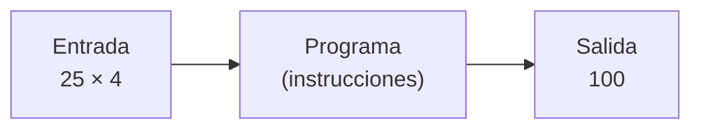
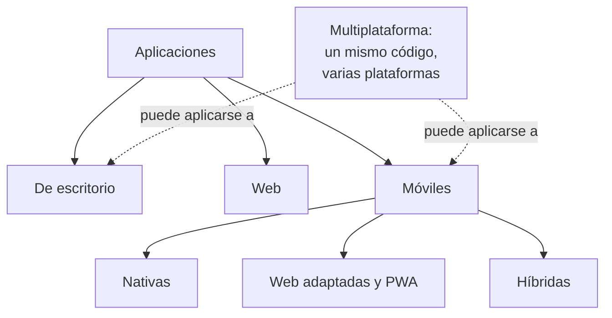
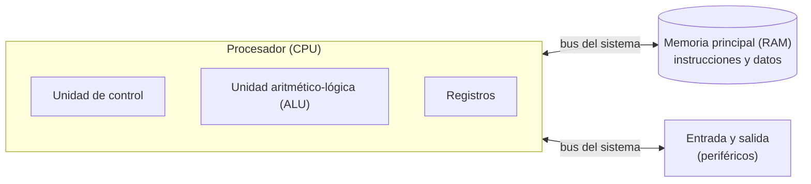
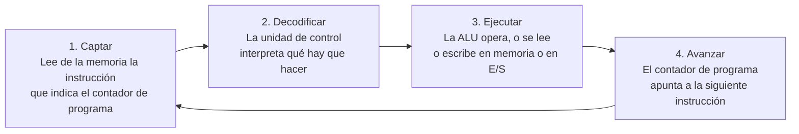
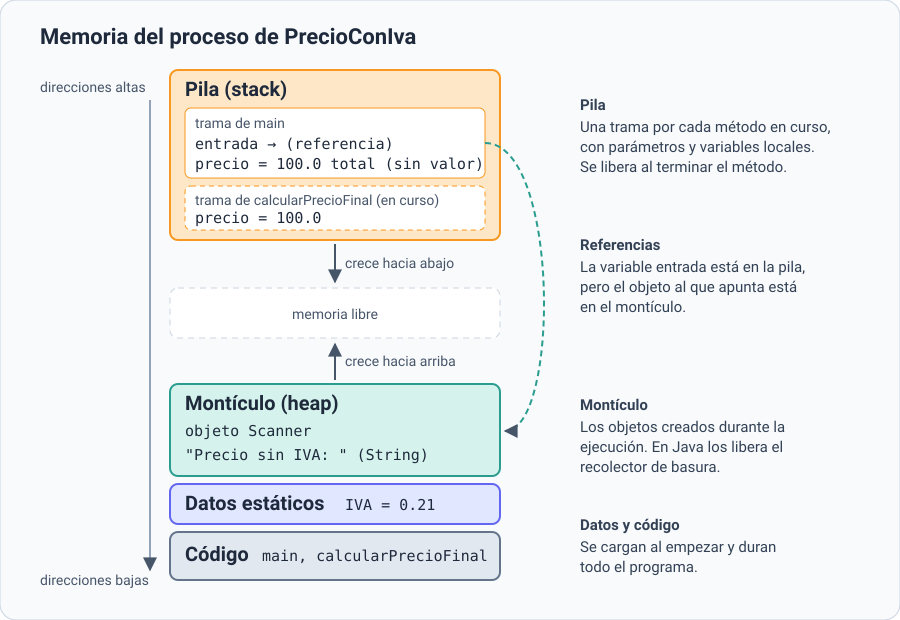
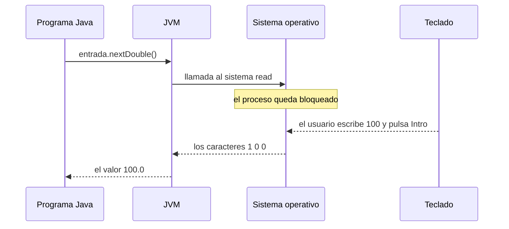
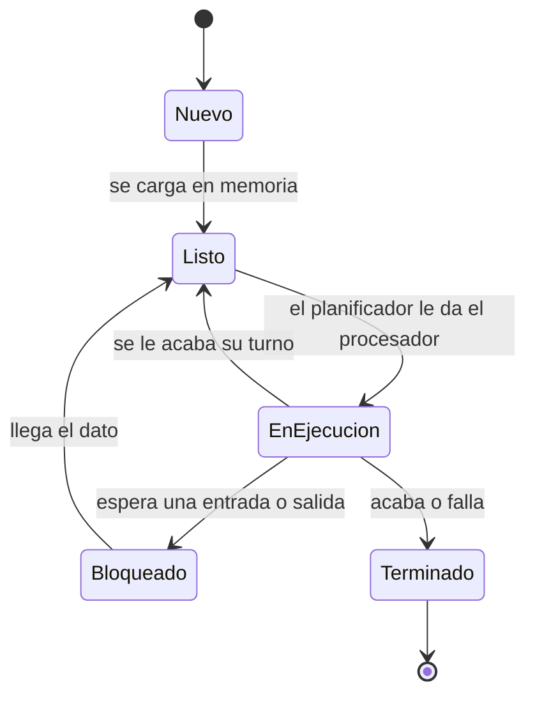

# 1. El programa y el sistema informático

[⬅️ Volver a la unidad](./README.md)

## Índice

- [1.1. Qué es un programa](#11-qué-es-un-programa)
  - [1.1.1. Del algoritmo al programa](#111-del-algoritmo-al-programa)
  - [1.1.2. Programa y aplicación informática](#112-programa-y-aplicación-informática)
- [1.2. Tipos de software y de aplicaciones](#12-tipos-de-software-y-de-aplicaciones)
  - [1.2.1. Software de sistema, de desarrollo y de aplicación](#121-software-de-sistema-de-desarrollo-y-de-aplicación)
  - [1.2.2. Aplicaciones de escritorio, web, móviles y multiplataforma](#122-aplicaciones-de-escritorio-web-móviles-y-multiplataforma)
- [1.3. Los componentes del sistema informático](#13-los-componentes-del-sistema-informático)
  - [1.3.1. La arquitectura de Von Neumann](#131-la-arquitectura-de-von-neumann)
  - [1.3.2. La jerarquía de memoria](#132-la-jerarquía-de-memoria)
- [1.4. Qué pasa cuando ejecutas un programa](#14-qué-pasa-cuando-ejecutas-un-programa)
  - [1.4.1. El sistema operativo lo carga en memoria](#141-el-sistema-operativo-lo-carga-en-memoria)
  - [1.4.2. El procesador ejecuta sus instrucciones](#142-el-procesador-ejecuta-sus-instrucciones)
  - [1.4.3. Las zonas de memoria de un programa](#143-las-zonas-de-memoria-de-un-programa)
  - [1.4.4. Los periféricos, siempre a través del sistema operativo](#144-los-periféricos-siempre-a-través-del-sistema-operativo)
  - [1.4.5. Los estados de un proceso](#145-los-estados-de-un-proceso)
- [1.5. Ejemplo integrador: un programa Java paso a paso](#15-ejemplo-integrador-un-programa-java-paso-a-paso)
- [Resumen](#resumen)
- [Ejercicios de reflexión](#ejercicios-de-reflexión)

> **CE que trabaja este tema:** RA1 a.

---

## 1.1. Qué es un programa

Abres el móvil, pulsas el icono de la calculadora, escribes `25 × 4` y aparece `100`. Detrás de ese gesto tan simple hay un **programa**: alguien escribió, en un lenguaje que el ordenador puede llegar a entender, la lista exacta de pasos que hay que dar para leer lo que tecleas, hacer la multiplicación y mostrar el resultado.

Un **programa informático** (*computer program*) es un conjunto de **instrucciones**, escritas en un **lenguaje de programación**, que indican a un ordenador cómo realizar una tarea concreta. Tiene tres rasgos:

- Está escrito en un **lenguaje de programación** (Java, Python, C…), con unas reglas precisas.
- Se puede **ejecutar**: el ordenador, directamente o con ayuda de otro programa, sigue sus instrucciones.
- Trabaja con **datos**: recibe una entrada, la procesa y produce una salida.



El esquema entrada, proceso y salida describe casi cualquier programa: una calculadora, un procesador de textos o un videojuego, que lee el mando y dibuja la pantalla sesenta veces por segundo.

### 1.1.1. Del algoritmo al programa

Antes de escribir un programa hay que saber **qué pasos** resuelven el problema. Esa lista de pasos es un **algoritmo** (*algorithm*): una secuencia **finita** y **ordenada** de instrucciones **precisas** que resuelve un problema.

| | Algoritmo | Programa |
|---|-----------|----------|
| Qué es | La idea: los pasos para resolver el problema | La implementación de esa idea en un lenguaje concreto |
| Cómo se escribe | En lenguaje natural, en pseudocódigo o con un diagrama de flujo | En un lenguaje de programación (Java, Python, C…) |
| ¿Se ejecuta? | No directamente: lo «ejecuta» una persona que lo sigue | Sí, en un ordenador |
| Ejemplo | «Multiplica el precio por 1,21 y muestra el resultado» | `double total = precio * 1.21;` |

Un mismo algoritmo se puede implementar en muchos lenguajes, y cada implementación es un programa distinto. En el [tema 2](./02-lenguajes-de-programacion.md) verás el mismo algoritmo escrito en cinco lenguajes.

> 📝 **Nota del Profesor**: Diseñar algoritmos y escribirlos en Java es el objeto del módulo de **Programación**. En Entornos de Desarrollo nos interesa todo lo que **rodea** al programa: cómo se convierte en algo que el ordenador ejecuta, con qué herramientas se escribe, se prueba y se documenta, y cómo se organiza el trabajo de quienes lo desarrollan.

### 1.1.2. Programa y aplicación informática

En el lenguaje de la calle, «programa» y «aplicación» se usan como sinónimos. En el desarrollo de software conviene distinguirlos:

- Un **programa** es un conjunto de instrucciones ejecutables que hace una tarea.
- Una **aplicación informática** (*software application*) es un producto completo pensado para que un usuario resuelva un problema: uno o varios programas, junto con los **datos**, la **configuración**, las **bibliotecas** que usa y la **documentación**.

Por ejemplo, una aplicación de gestión de una biblioteca está formada por el programa de escritorio que usa el personal, el programa del servidor que guarda los préstamos, la base de datos, los ficheros de configuración y el manual de usuario.

Las partes que suele tener una aplicación (no todas las tienen, y a veces se mezclan) son:

| Parte | Qué hace | Ejemplo en una tienda en línea |
|-------|----------|--------------------------------|
| **Lógica de negocio** | Las reglas y los cálculos propios del problema | Calcular el precio con descuentos e impuestos |
| **Interfaz de usuario** | Lo que ve y usa la persona: gráfica (*GUI*) o de línea de órdenes (*CLI*) | Las páginas del catálogo y del carrito |
| **Gestión de datos** | Guardar y recuperar la información | La base de datos de productos y pedidos |
| **Comunicaciones** | Hablar con otros sistemas a través de la red | El pago con la pasarela del banco |
| **Seguridad** | Saber quién es el usuario, qué puede hacer y proteger los datos | El inicio de sesión y el cifrado de la conexión |
| **Bibliotecas y *frameworks*** | Código reutilizable hecho por otros | La biblioteca que genera las facturas en PDF |
| **Pruebas y documentación** | Comprobar que funciona y explicar cómo se usa y se mantiene | Los tests automáticos y el manual de instalación |

> ✅ **Buena práctica**: Separa la **lógica de negocio** de la **interfaz**. Si el cálculo del precio está mezclado con las instrucciones que leen el teclado y escriben en la pantalla, no se puede probar ni reutilizar. En los ejemplos del curso verás siempre esa separación: un método que calcula y la clase con `main`, que lee y muestra.

---

## 1.2. Tipos de software y de aplicaciones

### 1.2.1. Software de sistema, de desarrollo y de aplicación

Según su función, el software se suele clasificar en tres grandes tipos:

| Tipo | Para qué sirve | Ejemplos |
|------|----------------|----------|
| **Software de sistema** | Gestiona el hardware y ofrece servicios al resto de programas | Sistemas operativos (Windows, GNU/Linux, macOS, Android), controladores de dispositivos (*drivers*), cargador de arranque |
| **Software de desarrollo** (o de programación) | Sirve para crear otros programas | Compiladores, intérpretes, entornos de desarrollo (IDE), depuradores, control de versiones |
| **Software de aplicación** | Resuelve tareas de los usuarios finales | Procesadores de texto, navegadores, videojuegos, aplicaciones de gestión |

Las fronteras no son siempre nítidas: un navegador es software de aplicación, pero sus herramientas para desarrolladores son software de desarrollo. En este módulo trabajarás sobre todo con el **software de desarrollo**.

### 1.2.2. Aplicaciones de escritorio, web, móviles y multiplataforma

Según **dónde se ejecutan** y **cómo llegan al usuario**, las aplicaciones se dividen en:

- **De escritorio** (*desktop*): se instalan en el ordenador y se ejecutan en él. Pueden funcionar sin conexión. Ejemplos: LibreOffice, GIMP, un IDE.
- **Web**: se ejecutan en parte en un **servidor** y en parte en el **navegador** del usuario, que no instala nada. Ejemplos: el correo web, una plataforma de cursos en línea, una tienda en línea.
- **Móviles**: se ejecutan en un teléfono o una tableta. Pueden ser:
  - **Nativas**: escritas para una plataforma con su lenguaje y sus herramientas (Kotlin para Android, Swift para iOS). Aprovechan todo el dispositivo y se distribuyen en tiendas de aplicaciones.
  - **Web adaptadas** y **aplicaciones web progresivas** (*PWA*): páginas web que se ven y se comportan como una aplicación; algunas se pueden «instalar» desde el navegador.
  - **Híbridas**: una aplicación web metida dentro de una aplicación nativa que la muestra.

¿Y las **aplicaciones multiplataforma**? Son las que, a partir de **un mismo código**, funcionan en **varias plataformas** (Windows, macOS, GNU/Linux, Android, iOS…). No son un cuarto tipo al lado de los anteriores, sino una **característica**: puede ser multiplataforma una aplicación de escritorio, una móvil o las dos a la vez. Ejemplos de tecnologías multiplataforma: Java con su máquina virtual, Kotlin Multiplatform, Flutter o .NET MAUI.

> ⚠️ **Cuidado**: «Multiplataforma» **no** significa «móvil». Es justo el nombre de este ciclo: Desarrollo de Aplicaciones **Multiplataforma**. Una aplicación de escritorio escrita en Java que funciona igual en Windows y en GNU/Linux es multiplataforma, y una aplicación de Android escrita solo para Android no lo es.



El diagrama muestra la clasificación por dónde se ejecuta la aplicación; la línea discontinua recuerda que «multiplataforma» es una propiedad que se suma a cualquiera de los tipos.

> 💡 **Tip del Examinador**: Si te preguntan la diferencia entre una aplicación web y una de escritorio, la clave es **dónde se ejecuta y si hay que instalarla**: la de escritorio se instala y se ejecuta en el equipo del usuario; la web se ejecuta en un servidor y en el navegador, sin instalar nada.

---

## 1.3. Los componentes del sistema informático

Un programa no hace nada por sí solo: necesita un **sistema informático** donde ejecutarse. El sistema informático lo forman el **hardware** (la parte física), el **software** (los programas) y las personas que lo usan. Para entender qué hace un programa al ejecutarse, primero hay que conocer el hardware que lo ejecuta.

### 1.3.1. La arquitectura de Von Neumann

Casi todos los ordenadores actuales, del portátil al móvil, siguen la idea que describió John von Neumann en 1945: el **programa almacenado** (*stored-program*). Las instrucciones del programa y los datos con los que trabaja se guardan **en la misma memoria**, y el procesador las va leyendo de ella.



El diagrama muestra los tres bloques y el bus que los une: todo lo que entra o sale del procesador pasa por el bus.

| Componente | Función |
|------------|---------|
| **Unidad de control** (*control unit*) | Lee cada instrucción de la memoria, la interpreta y da las órdenes para ejecutarla |
| **Unidad aritmético-lógica** (*ALU*) | Hace las operaciones: sumas, comparaciones, operaciones lógicas |
| **Registros** | Memorias diminutas y rapidísimas dentro del procesador. Dos importantes: el **contador de programa** (*program counter*, la dirección de la siguiente instrucción) y el **registro de instrucción** (la instrucción que se está ejecutando) |
| **Memoria principal** (*RAM*) | Guarda las instrucciones y los datos de los programas en ejecución. Es **volátil**: se borra al apagar |
| **Entrada y salida** (*E/S*) | Los **periféricos**: de entrada (teclado, ratón, micrófono), de salida (pantalla, impresora, altavoces) y de entrada y salida (disco, red, pantalla táctil) |
| **Bus del sistema** | Las líneas por las que viajan los datos, las direcciones y las señales de control entre los demás componentes |

> 📝 **Nota del Profesor**: Fíjate en que el disco duro o el SSD es, para el procesador, un **periférico más**. Un programa guardado en el disco no se puede ejecutar ahí: antes hay que copiarlo a la memoria principal. Esa copia es lo primero que pasa cuando haces doble clic en un programa (apartado 1.4.1).

### 1.3.2. La jerarquía de memoria

El procesador es mucho más rápido que la memoria principal, y esta mucho más rápida que el disco. Para que el procesador no pase la mayor parte del tiempo esperando, el sistema organiza la memoria en **niveles**:

| Nivel | Tamaño típico | Velocidad | ¿Se conserva al apagar? |
|-------|---------------|-----------|-------------------------|
| Registros | Bytes | La más alta | No |
| Memoria caché (dentro del procesador) | Kilobytes a megabytes | Muy alta | No |
| Memoria principal (RAM) | Gigabytes | Alta | No |
| Almacenamiento (SSD, disco duro) | Cientos de gigabytes a terabytes | Baja | Sí |

Cuanto más cerca del procesador, más rápida, más pequeña y más cara. La **caché** guarda copias de los datos y las instrucciones que se acaban de usar, porque es probable que se vuelvan a necesitar enseguida.

Esto tiene consecuencias para el desarrollo: un programa que lee del disco una y otra vez el mismo dato es mucho más lento que uno que lo lee una vez y lo guarda en una variable, porque las variables están en la memoria principal (y, con suerte, en la caché).

---

## 1.4. Qué pasa cuando ejecutas un programa

Este es el apartado central del tema: la relación entre el programa y los componentes del sistema **mientras se ejecuta**. Lo verás en cinco pasos.

### 1.4.1. El sistema operativo lo carga en memoria

Un programa guardado en el disco es solo un fichero. Cuando lo ejecutas (con doble clic o escribiendo una orden en la terminal), el **sistema operativo**:

1. Comprueba que tienes permiso para ejecutarlo.
2. Crea un **proceso** (*process*): el programa **en ejecución**, con su propia memoria y su identificador (*PID*).
3. Reserva memoria principal para el proceso.
4. El **cargador** (*loader*), una parte del sistema operativo, copia las instrucciones del programa del disco a esa memoria y prepara lo que necesita para arrancar.
5. Pone en el contador de programa la dirección de la primera instrucción y el procesador empieza a ejecutarlo.

> 💡 **Tip del Examinador**: **Programa** y **proceso** no son lo mismo. El programa es el fichero con las instrucciones; el proceso es ese programa **en ejecución**, con su memoria y su estado. Si abres dos veces el mismo editor de texto, tienes **un** programa y **dos** procesos.

### 1.4.2. El procesador ejecuta sus instrucciones

Una vez en memoria, el procesador repite sin parar el **ciclo de instrucción** (*fetch-decode-execute cycle*), también llamado ciclo de captación y ejecución:



El ciclo se repite miles de millones de veces por segundo: la **frecuencia de reloj** del procesador, en gigahercios (GHz), indica cuántos ciclos de reloj hace por segundo. Un procesador actual tiene además varios **núcleos** (*cores*), cada uno con su propio ciclo, y puede ejecutar varios procesos a la vez.

Una sola línea de Java se convierte en **varias** instrucciones de máquina. Por ejemplo, `total = precio * 1.21;` supone, a grandes rasgos, leer `precio` de la memoria a un registro, multiplicarlo en la ALU y escribir el resultado en la posición de memoria de `total`. Cómo se pasa de la línea de Java a esas instrucciones lo verás en el [tema 3](./03-del-codigo-al-ejecutable.md).

### 1.4.3. Las zonas de memoria de un programa

La memoria que el sistema operativo da a un proceso no es un bloque desordenado: se organiza en **zonas** con funciones distintas.



La imagen muestra las cuatro zonas de la memoria de un proceso y qué guarda cada una en el programa del ejemplo del apartado 1.5, en el momento en que se está calculando el precio: el montículo y la pila crecen el uno hacia el otro.

| Zona | Qué guarda | Cuándo se reserva y se libera |
|------|------------|-------------------------------|
| **Código** (*text*) | Las instrucciones del programa | Al cargarlo; no cambia mientras se ejecuta |
| **Datos estáticos** | Las variables globales y las constantes | Al cargarlo; duran todo el programa |
| **Montículo** (*heap*) | Los datos que se crean durante la ejecución y cuyo tamaño o duración no se conoce de antemano: en Java, **todos los objetos** (`new Scanner(...)`, los `String`…) | Cuando el programa los crea; en Java los libera el **recolector de basura** (*garbage collector*) cuando ya nadie los usa |
| **Pila** (*stack*) | Una **trama** (*frame*) por cada llamada a un método en curso, con sus parámetros y sus variables locales (`precio`, `total`…) | Se apila al llamar al método y se desapila al terminar |

Cuando un método llama a otro, se apila una trama nueva encima; cuando el llamado termina, su trama desaparece y se vuelve a la anterior. Por eso las variables locales de un método **dejan de existir** cuando el método termina.

> ⚠️ **Cuidado**: La pila tiene un tamaño limitado. Un método que se llama a sí mismo sin fin (una **recursión** sin caso base) apila tramas hasta agotarla, y Java detiene el programa con un `StackOverflowError`. Si llenas el montículo con objetos que nunca dejas de usar, el error es `OutOfMemoryError`.

En un programa en C, el compilador decide la mayor parte de este reparto y el programador libera a mano lo que reserva en el montículo. En Java, el programa se ejecuta dentro de la **máquina virtual de Java** (JVM), que es la que pide la memoria al sistema operativo y la organiza (pila, montículo y una zona con el código de las clases); lo verás en el [tema 3](./03-del-codigo-al-ejecutable.md).

### 1.4.4. Los periféricos, siempre a través del sistema operativo

Un programa **nunca** habla directamente con el teclado, la pantalla o el disco. Lo hace siempre **a través del sistema operativo**, que es el único que controla el hardware mediante sus **controladores** (*drivers*). El programa pide un servicio con una **llamada al sistema** (*system call*): «lee lo que se escriba en el teclado», «escribe este texto en la pantalla», «abre este fichero».



El diagrama sigue una lectura del teclado: el programa pide el dato, la petición baja hasta el sistema operativo y el proceso **espera** hasta que el usuario pulsa Intro.

Gracias a esta capa intermedia:

- El mismo programa funciona con cualquier teclado o pantalla, porque el que conoce los detalles de cada dispositivo es el controlador.
- Un programa no puede leer la memoria de otro ni escribir donde quiera en el disco: el sistema operativo **protege** los recursos.
- Varios programas pueden compartir la pantalla, la red o la impresora sin pisarse.

### 1.4.5. Los estados de un proceso

Mientras esperaba a que escribieras en el teclado, el proceso del diagrama anterior no estaba usando el procesador. El sistema operativo lleva la cuenta de **en qué estado** está cada proceso y reparte el procesador entre los que están listos.



El diagrama muestra el ciclo de vida de un proceso; lo importante es que un proceso que espera un periférico pasa a **bloqueado** y deja el procesador libre para otros.

| Estado | Qué significa |
|--------|---------------|
| Nuevo | El sistema operativo lo está creando |
| Listo | Está en memoria y podría ejecutarse, pero espera su turno en el procesador |
| En ejecución | El procesador está ejecutando sus instrucciones |
| Bloqueado | Espera algo externo: una tecla, un fichero del disco, datos de la red |
| Terminado | Ha acabado (bien o con un error) y el sistema libera su memoria |

Puedes ver los procesos de tu equipo con el **Administrador de tareas** de Windows (pestaña **Detalles**), el **Monitor de actividad** de macOS o las órdenes `ps` y `top` en GNU/Linux y macOS. Cada fila es un proceso, con su identificador (PID), su estado y la memoria y el procesador que usa.

---

## 1.5. Ejemplo integrador: un programa Java paso a paso

Vas a seguir un programa pequeño desde que lo ejecutas hasta que termina, fijándote en qué componente interviene en cada paso. El programa pide un precio y muestra el precio con el IVA general del 21 %.

```java
import java.util.Scanner;

/**
 * Calcula el precio final de un producto con el IVA general.
 */
public class PrecioConIva {

    /** Tipo de IVA general, en tanto por uno. */
    static final double IVA = 0.21;

    /**
     * Calcula el precio con IVA.
     *
     * @param precio precio sin IVA, en euros
     * @return precio con IVA, en euros
     */
    static double calcularPrecioFinal(double precio) {
        return precio * (1 + IVA);
    }

    public static void main(String[] args) {
        Scanner entrada = new Scanner(System.in);
        System.out.print("Precio sin IVA: ");
        double precio = entrada.nextDouble();
        double total = calcularPrecioFinal(precio);
        System.out.printf("Precio con IVA: %.2f euros%n", total);
    }
}
```

Guarda el código en un fichero `PrecioConIva.java` y ejecútalo desde la terminal, en la carpeta del fichero. Desde Java 11, la orden `java` puede ejecutar directamente un fichero fuente (lo compila en memoria antes de ejecutarlo; en el [tema 3](./03-del-codigo-al-ejecutable.md) separarás los dos pasos):

```bash
java PrecioConIva.java
```

Escribe `100` y pulsa Intro:

```text
Precio sin IVA: 100
Precio con IVA: 121,00 euros
```

El resultado sale con coma decimal porque `printf` usa la configuración regional del equipo, que en España es la española. En un equipo configurado en inglés verías `121.00`.

> ⚠️ **Cuidado**: `nextDouble()` también usa la configuración regional para **leer**. Con la configuración española, si escribes `100.5` el programa falla con un `InputMismatchException`: hay que escribir `100,5`. Es un ejemplo de cómo el sistema operativo (su configuración) influye en el comportamiento de un programa.

Ahora, paso a paso, qué componente interviene:

| Paso | Qué ocurre | Componentes que intervienen |
|------|------------|-----------------------------|
| 1 | Escribes la orden y pulsas Intro | Teclado (periférico de entrada), sistema operativo y la terminal |
| 2 | El sistema operativo crea el proceso de la JVM, el cargador la copia del disco a la memoria y le da el procesador | Almacenamiento, memoria principal, procesador |
| 3 | La JVM carga la clase `PrecioConIva` (su código va a la zona de código) y la constante `IVA` | Memoria principal (código y datos estáticos) |
| 4 | Empieza `main`: se apila su trama en la pila | Memoria (pila) |
| 5 | `new Scanner(System.in)` crea un objeto | Memoria (montículo); la variable `entrada` de la pila guarda la referencia al objeto |
| 6 | `System.out.print(...)` muestra el mensaje | Llamada al sistema, controlador y pantalla (periférico de salida) |
| 7 | `nextDouble()` espera a que escribas | El proceso pasa a **bloqueado**; el teclado y el sistema operativo entregan los caracteres al pulsar Intro |
| 8 | Se guarda `100.0` en `precio` | Memoria (pila, trama de `main`) |
| 9 | Se llama a `calcularPrecioFinal`: se apila su trama con el parámetro, la ALU multiplica y la trama se desapila al devolver el resultado | Procesador (ALU y registros), memoria (pila) |
| 10 | `printf` muestra el resultado | Llamada al sistema y pantalla |
| 11 | Termina `main`, la JVM termina y el sistema operativo libera toda la memoria del proceso | Sistema operativo, memoria principal |

Mientras el programa espera en el paso 7, búscalo en el administrador de tareas: aparece como un proceso `java` (o `java.exe`) que **no consume procesador**, porque está bloqueado, aunque sí ocupa memoria.

> 📝 **Nota del Profesor**: Lo que acabas de seguir es el CE a de esta unidad: la relación del programa con la memoria, el procesador y los periféricos. Si en un examen te dan un programa corto y te piden qué componente interviene en cada línea, sigue esta tabla: **¿dónde se guarda?** (pila, montículo, código), **¿quién calcula?** (procesador) y **¿con qué periférico se comunica, a través de quién?** (sistema operativo).

---

## Resumen

- Un **programa** es un conjunto de instrucciones escritas en un lenguaje de programación que el ordenador puede ejecutar; un **algoritmo** es la idea, los pasos, independiente del lenguaje.
- Una **aplicación informática** es un producto completo: uno o varios programas, datos, configuración, bibliotecas y documentación.
- El software se clasifica en **de sistema**, **de desarrollo** y **de aplicación**; las aplicaciones, en **de escritorio**, **web** y **móviles** (nativas, web y PWA, híbridas). **Multiplataforma** es una característica: un mismo código para varias plataformas.
- La **arquitectura de Von Neumann** guarda instrucciones y datos en la misma memoria. Componentes: procesador (unidad de control, ALU y registros), memoria principal, entrada y salida, y bus.
- Al ejecutar un programa, el sistema operativo crea un **proceso**, el **cargador** lo copia a memoria y el procesador repite el **ciclo de instrucción**: captar, decodificar, ejecutar y avanzar.
- La memoria de un proceso tiene **código**, **datos estáticos**, **montículo** (los objetos, en Java) y **pila** (una trama por cada método en curso, con sus variables locales).
- Los programas usan los **periféricos** a través del **sistema operativo**, con llamadas al sistema. Mientras esperan una entrada o salida, los procesos están **bloqueados**.

## Ejercicios de reflexión

1. Abre el administrador de tareas de tu equipo y localiza el navegador. ¿Cuántos procesos tiene? ¿Por qué crees que un mismo programa usa varios procesos?
2. Tu móvil tiene una aplicación del banco y también puedes entrar al banco desde el navegador. ¿Qué tipo de aplicación es cada una? ¿Alguna es multiplataforma?
3. Explica con tus palabras por qué un programa no puede escribir directamente en la pantalla y qué ganamos con que todo pase por el sistema operativo.
4. En el ejemplo del apartado 1.5, ¿en qué zona de memoria está `total`? ¿Y el objeto `Scanner`? ¿Qué pasa con cada uno cuando termina `main`?

---

[⬅️ Volver a la unidad](./README.md)
