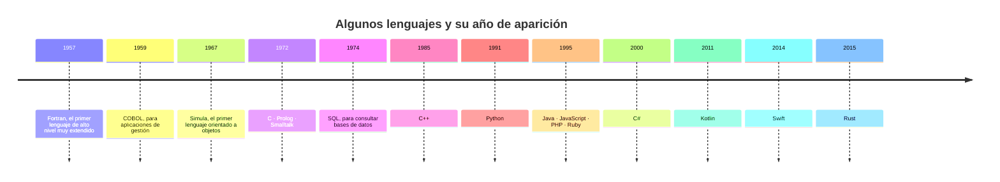

# 2. Lenguajes de programación

[⬅️ Volver a la unidad](./README.md)

## Índice

- [2.1. Qué es un lenguaje de programación](#21-qué-es-un-lenguaje-de-programación)
- [2.2. Clasificación por nivel](#22-clasificación-por-nivel)
  - [2.2.1. ¿Y la inteligencia artificial?](#221-y-la-inteligencia-artificial)
- [2.3. Generaciones y un poco de historia](#23-generaciones-y-un-poco-de-historia)
- [2.4. Clasificación por la forma de traducirse](#24-clasificación-por-la-forma-de-traducirse)
- [2.5. Clasificación por paradigma](#25-clasificación-por-paradigma)
  - [2.5.1. Imperativo y estructurado](#251-imperativo-y-estructurado)
  - [2.5.2. Orientado a objetos](#252-orientado-a-objetos)
  - [2.5.3. Funcional](#253-funcional)
  - [2.5.4. Declarativo](#254-declarativo)
  - [2.5.5. Lógico](#255-lógico)
  - [2.5.6. Orientado a eventos](#256-orientado-a-eventos)
  - [2.5.7. Lenguajes multiparadigma](#257-lenguajes-multiparadigma)
- [2.6. Clasificación por tipado](#26-clasificación-por-tipado)
- [2.7. Clasificación por propósito](#27-clasificación-por-propósito)
- [2.8. Ejemplo integrador: el mismo algoritmo en cinco lenguajes](#28-ejemplo-integrador-el-mismo-algoritmo-en-cinco-lenguajes)
- [2.9. Los lenguajes más difundidos](#29-los-lenguajes-más-difundidos)
- [Resumen](#resumen)
- [Ejercicios de reflexión](#ejercicios-de-reflexión)

> **CE que trabaja este tema:** RA1 e.

---

## 2.1. Qué es un lenguaje de programación

Para pedirle algo a otra persona usas un idioma: español, inglés… Para pedirle algo a un ordenador usas un **lenguaje de programación** (*programming language*): un lenguaje **formal**, con un vocabulario y unas reglas fijas, con el que se escriben las instrucciones de un programa.

A diferencia de los idiomas, un lenguaje de programación **no admite ambigüedad**: cada frase correcta significa exactamente una cosa. Todo lenguaje se define por tres elementos:

| Elemento | Qué define | Ejemplo en Java |
|----------|------------|-----------------|
| **Léxico** | Las «palabras» válidas: palabras reservadas, identificadores, números, operadores, signos | `int`, `precio`, `21`, `*`, `;` |
| **Sintaxis** | Cómo se combinan las palabras en instrucciones correctas | `int total = precio * 2;` es correcta; `int = total precio 2` no lo es |
| **Semántica** | Qué significa cada instrucción correcta y qué hace al ejecutarse | `total = precio * 2` multiplica y guarda el resultado en `total` |

Un programa con un error de sintaxis no se puede traducir: el traductor lo rechaza y dice dónde está el error. Un programa sintácticamente correcto puede tener errores de semántica (hace algo, pero no lo que querías). Lo verás con ejemplos en el [tema 3](./03-del-codigo-al-ejecutable.md).

> ⚠️ **Cuidado**: **HTML**, **XML** o **Markdown** son **lenguajes de marcas** (*markup languages*): describen la estructura o el formato de un documento, pero no tienen variables, decisiones ni bucles. No son lenguajes de programación, aunque se usen al programar.

---

## 2.2. Clasificación por nivel

El **nivel** de un lenguaje indica lo cerca que está del **hardware** (bajo nivel) o de la forma de pensar de las **personas** (alto nivel).

Para verlo, aquí tienes la misma operación, «guarda un 5 y súmale 3», en tres niveles. Los dos primeros son para los procesadores de la familia x86-64, los de la mayoría de los ordenadores de sobremesa y portátiles:

**Lenguaje máquina** (*machine code*). Lo único que el procesador entiende directamente: instrucciones codificadas en binario. Se suelen escribir en hexadecimal para que sean más cortas.

```text
B8 05 00 00 00
83 C0 03
```

**Lenguaje ensamblador** (*assembly language*). Cada instrucción de máquina se escribe con un nombre corto que se puede recordar (un **mnemónico**). Un programa llamado **ensamblador** (*assembler*) lo traduce a lenguaje máquina, casi uno a uno.

```text
mov eax, 5      ; guarda un 5 en el registro eax
add eax, 3      ; súmale 3
```

**Lenguaje de alto nivel** (*high-level language*). Se escribe con palabras y símbolos cercanos al lenguaje humano y a las matemáticas, sin pensar en registros ni direcciones de memoria.

```java
int resultado = 5 + 3;
```

| | Bajo nivel (máquina y ensamblador) | Alto nivel |
|---|-----------------------------------|------------|
| Cercanía | Al hardware | A la persona |
| Portabilidad | Ninguna: cada familia de procesadores tiene el suyo | Alta: el mismo código sirve en distintos equipos |
| Facilidad de escritura y lectura | Muy baja | Alta |
| Control del hardware | Total | Limitado (depende del lenguaje) |
| Uso actual | Partes muy concretas de sistemas operativos, controladores, sistemas empotrados y optimizaciones | Casi todo el software |
| Ejemplos | Ensamblador x86-64, ARM | Java, Python, C#, JavaScript, Kotlin |

> 💡 **Tip del Examinador**: El lenguaje **máquina** y el **ensamblador** son los dos de bajo nivel, y los dos dependen del procesador. La diferencia es que el ensamblador usa mnemónicos legibles (`mov`, `add`) y necesita un programa ensamblador que lo traduzca a máquina.

A veces se dice que C es un lenguaje de **nivel medio**: es de alto nivel, pero permite manejar direcciones de memoria y bits como el ensamblador. Por eso se usa para escribir sistemas operativos y controladores.

### 2.2.1. ¿Y la inteligencia artificial?

Cada nivel ha alejado un poco más al programador de la máquina: el ensamblador cambió los números por palabras, y los lenguajes de alto nivel cambiaron los registros por variables. Con los asistentes de código con IA ([tema 6](./06-herramientas-del-desarrollo.md)) se da un paso más: describes en lenguaje natural lo que quieres («una función que diga si un número es primo») y el asistente escribe el código Java.

| | Del ensamblador a la máquina | Del alto nivel a la máquina | Del lenguaje natural al código |
|---|---|---|---|
| Quién traduce | El ensamblador | El compilador o el intérprete | Un modelo de IA |
| ¿Es ambigua la entrada? | No | No | Sí: «ordena la lista» no dice si de mayor a menor o al revés |
| ¿La misma entrada da siempre lo mismo? | Sí | Sí | No necesariamente |
| ¿Se garantiza que la traducción es correcta? | Sí: es exacta | Sí: el programa hace lo que dice el código | No: el código puede compilar y hacer otra cosa |
| Qué obtienes | Código máquina | Código máquina o *bytecode* | **Código fuente** en un lenguaje de programación, que después hay que compilar |

Por eso el lenguaje natural **no** es un lenguaje de programación (apartado 2.1): no tiene una sintaxis ni una semántica que garanticen un único significado. La IA no sustituye a los niveles anteriores, se apoya en ellos: lo que genera sigue siendo código Java que hay que leer, entender, compilar y probar.

> 📝 **Nota del Profesor**: Cuanto más sube el nivel de abstracción, más importa saber qué pasa por debajo. Quien entiende el código que genera un asistente puede detectar sus errores; quien no lo entiende, solo puede confiar en él.

---

## 2.3. Generaciones y un poco de historia

Otra forma tradicional de clasificar los lenguajes es por **generaciones** (*GL*, de *generation language*). No es una norma oficial y verás variaciones según el autor, pero la clasificación más habitual es esta:

| Generación | Qué es | Ejemplos |
|------------|--------|----------|
| 1.ª (1GL) | Lenguaje máquina | El binario de cada procesador |
| 2.ª (2GL) | Lenguaje ensamblador | Ensamblador x86-64, ARM |
| 3.ª (3GL) | Lenguajes de alto nivel de propósito general: el programador indica **cómo** hacer las cosas | Fortran, COBOL, C, Pascal, C++, Java, Python, C#, JavaScript |
| 4.ª (4GL) | Lenguajes orientados a un dominio concreto, más cercanos al **qué** que al **cómo**, como los de consulta de bases de datos o de informes | SQL, lenguajes de los generadores de informes |
| 5.ª (5GL) | Lenguajes basados en la lógica y en restricciones: se describe el problema y el sistema busca la solución | Prolog |

> ⚠️ **Cuidado**: Python, Java o JavaScript son de **tercera** generación, aunque sean recientes: la generación no depende de la fecha, sino del nivel de abstracción. Tampoco Fortran o COBOL son de segunda generación: fueron los primeros lenguajes de alto nivel (tercera generación).

La línea del tiempo muestra cuándo aparecieron algunos lenguajes que siguen siendo importantes o que influyeron en los actuales:



Fíjate en que casi todos los lenguajes que más se usan hoy tienen más de veinte años: un lenguaje tarda mucho en asentarse y, una vez asentado, dura décadas. Java nació en 1995 en Sun Microsystems con el lema «escribe una vez, ejecuta en cualquier parte» (*write once, run anywhere*), que verás en el [tema 3](./03-del-codigo-al-ejecutable.md).

---

## 2.4. Clasificación por la forma de traducirse

El ordenador solo ejecuta lenguaje máquina, así que cualquier programa de alto nivel tiene que **traducirse**. Según cómo se haga esa traducción:

| Forma | Cómo funciona | Ejemplos típicos |
|-------|---------------|------------------|
| **Compilado** | Un **compilador** traduce todo el programa a lenguaje máquina **antes** de ejecutarlo. Se obtiene un ejecutable | C, C++, Go, Rust |
| **Interpretado** | Un **intérprete** lee el programa y lo va ejecutando **mientras** lo traduce | Bash, las primeras versiones de BASIC; hoy, casi todos combinan las dos formas |
| **Máquina virtual** (o híbrido) | Un compilador traduce a un **código intermedio** (*bytecode*), y una **máquina virtual** lo ejecuta, interpretándolo y compilando a máquina las partes que más se usan | Java, Kotlin y Scala (en la JVM), C# (en el CLR de .NET) |

> 📝 **Nota del Profesor**: Ser compilado o interpretado es una característica de la **implementación** del lenguaje (el traductor que se usa), no del lenguaje en sí. Python suele llamarse «interpretado», pero su implementación habitual (CPython) primero compila el código a *bytecode*. Los motores de JavaScript de los navegadores compilan a máquina el código que más se ejecuta. Lo verás con detalle en el [tema 3](./03-del-codigo-al-ejecutable.md).

---

## 2.5. Clasificación por paradigma

Un **paradigma de programación** (*programming paradigm*) es un **estilo** o una forma de pensar los programas: cómo se organiza el código y cómo se describe la solución. Para comparar, en casi todos los paradigmas verás el mismo problema: **sumar los números pares de una lista**.

### 2.5.1. Imperativo y estructurado

El programa es una **secuencia de órdenes** que van **cambiando el estado** (el valor de las variables). El programador dice **cómo** se hace todo, paso a paso.

La **programación estructurada** es la forma ordenada de la imperativa: solo usa tres estructuras de control (**secuencia**, **decisión** y **repetición**), sin saltos arbitrarios. La **procedimental** añade la división del programa en procedimientos o funciones que se pueden reutilizar.

```java
int[] numeros = {3, 8, 5, 12, 7, 6};
int suma = 0;
for (int numero : numeros) {
    if (numero % 2 == 0) {
        suma = suma + numero;
    }
}
// suma vale 26
```

Lenguajes: C, Pascal, Fortran, COBOL, y la parte imperativa de casi todos los demás.

### 2.5.2. Orientado a objetos

El programa se organiza en **objetos** que juntan **datos** (atributos) y **comportamiento** (métodos). Los objetos se crean a partir de **clases** y colaboran enviándose mensajes (llamadas a métodos). Sus pilares son la **encapsulación**, la **herencia**, el **polimorfismo** y la **abstracción**.

```java
class Lista {
    private final int[] numeros;

    Lista(int[] numeros) {
        this.numeros = numeros;
    }

    int sumarPares() {
        int suma = 0;
        for (int numero : numeros) {
            if (numero % 2 == 0) {
                suma = suma + numero;
            }
        }
        return suma;
    }
}
// new Lista(new int[] {3, 8, 5, 12, 7, 6}).sumarPares() devuelve 26
```

Los datos (`numeros`) quedan dentro del objeto y solo se usan a través de sus métodos. Lenguajes: Java, C#, C++, Kotlin, Python, Ruby, Swift. El primero fue **Simula** (1967); Smalltalk (años setenta) lo popularizó.

### 2.5.3. Funcional

El programa se construye **combinando funciones**, como en matemáticas: una función recibe datos y devuelve un resultado **sin cambiar nada más** (sin efectos secundarios). Se evitan las variables que cambian de valor (**inmutabilidad**), y las funciones se pueden pasar como parámetros a otras (**funciones de orden superior**).

```java
int suma = IntStream.of(3, 8, 5, 12, 7, 6)
        .filter(numero -> numero % 2 == 0)
        .sum();
// suma vale 26
```

No hay bucle ni variable acumuladora: se describe la transformación (filtrar los pares y sumarlos). Como las funciones no comparten estado, es más fácil **repartir el trabajo** entre varios núcleos del procesador. Lenguajes: Haskell, Lisp, Erlang, Elixir, F#, y muchos multiparadigma con partes funcionales, como Java (desde Java 8, con las lambdas y los *streams*), Kotlin, Scala o JavaScript.

### 2.5.4. Declarativo

El programa describe **qué** resultado se quiere, no **cómo** obtenerlo; el cómo lo decide el sistema. La programación funcional y la lógica se consideran declarativas, pero el ejemplo más conocido es **SQL**:

```sql
SELECT SUM(numero) AS suma
FROM numeros
WHERE numero % 2 = 0;
```

No dice en qué orden recorrer la tabla ni cómo sumar: el gestor de la base de datos elige la mejor forma. Otros ejemplos declarativos: las expresiones regulares, los ficheros de configuración de una herramienta de construcción o CSS.

### 2.5.5. Lógico

El programa es un conjunto de **hechos** y **reglas** lógicas. Se le hacen **preguntas** (consultas), y el sistema **deduce** las respuestas a partir de los hechos y las reglas. Se usa en inteligencia artificial simbólica, sistemas expertos y problemas de búsqueda y de restricciones.

```prolog
% Hechos
progenitor(ana, luis).
progenitor(luis, marta).

% Regla: A es abuelo o abuela de N si A es progenitor de P y P es progenitor de N
abuelo(A, N) :- progenitor(A, P), progenitor(P, N).

% Consulta: ?- abuelo(ana, Quien).   Respuesta: Quien = marta.
```

Lenguaje principal: **Prolog** (1972).

### 2.5.6. Orientado a eventos

El flujo del programa no lo marca una secuencia fija, sino los **eventos** que ocurren: un clic, una tecla, un mensaje de la red, un temporizador. El programa registra **manejadores** (*event handlers*): funciones que se ejecutan cuando ocurre cada evento.

```javascript
boton.addEventListener("click", () => {
    resultado.textContent = "Has pulsado el botón";
});
```

Es el estilo de las **interfaces gráficas** (de escritorio, web y móviles) y de muchos servidores. Más que un lenguaje, es una forma de usar lenguajes como JavaScript, Java (en sus interfaces gráficas), C# o Kotlin.

### 2.5.7. Lenguajes multiparadigma

Casi ningún lenguaje actual es de un solo paradigma: la mayoría son **multiparadigma** y permiten elegir el estilo que mejor encaja con cada parte del problema. Java, por ejemplo, es sobre todo orientado a objetos, pero también imperativo (los bucles del 2.5.1), funcional (los *streams* del 2.5.3) y orientado a eventos (en sus interfaces gráficas).

| Paradigma | Idea central | Lenguajes representativos |
|-----------|--------------|---------------------------|
| Imperativo y estructurado | Secuencia de órdenes que cambian el estado | C, Pascal, Fortran |
| Orientado a objetos | Objetos con datos y métodos que colaboran | Java, C#, C++, Kotlin, Python |
| Funcional | Funciones sin efectos secundarios que se combinan | Haskell, Erlang, Elixir, F# |
| Declarativo | Se describe el resultado, no los pasos | SQL, expresiones regulares |
| Lógico | Hechos, reglas y deducción | Prolog |
| Orientado a eventos | Manejadores que reaccionan a lo que ocurre | JavaScript, C# y Java en interfaces gráficas |

> 💡 **Tip del Examinador**: Una pregunta clásica es «¿qué paradigma se basa en hechos y reglas?» (el **lógico**) o «¿en cuál las funciones no tienen efectos secundarios?» (el **funcional**). Y otra: «¿qué diferencia hay entre imperativo y declarativo?»: el imperativo dice **cómo**, el declarativo dice **qué**.

> ⚠️ **Cuidado**: Términos como «programación concurrente», «asíncrona» o «de *scripting*» no son paradigmas al mismo nivel que los anteriores. La concurrencia (ejecutar varias tareas a la vez) se puede hacer en un estilo imperativo, orientado a objetos o funcional; *scripting* habla del uso del lenguaje (apartado 2.7).

---

## 2.6. Clasificación por tipado

Cada dato de un programa tiene un **tipo**: número entero, número real, texto, valor lógico… El **sistema de tipos** de un lenguaje decide **cuándo** se comprueban los tipos y **con qué rigor**.

**Estático o dinámico: ¿cuándo se comprueba el tipo?**

- **Tipado estático** (*static typing*): el tipo de cada variable se conoce **antes de ejecutar** (al compilar), y una variable no puede cambiar de tipo. Los errores de tipo se detectan pronto. Java, C, C#, Kotlin, Go, Rust, TypeScript.
- **Tipado dinámico** (*dynamic typing*): el tipo lo tiene el **valor**, no la variable, y se comprueba **al ejecutar**. Una variable puede guardar primero un número y luego un texto. Python, JavaScript, PHP, Ruby.

```java
int edad = 18;
edad = "dieciocho";   // error de compilación: incompatible types: String cannot be converted to int
```

```python
edad = 18
edad = "dieciocho"    # válido en Python: ahora edad guarda un texto
```

**Fuerte o débil: ¿se convierten los tipos solos?**

- **Tipado fuerte** (*strong typing*): el lenguaje no mezcla tipos incompatibles por su cuenta; si quieres convertir, lo dices tú. Java, Python, C#, Kotlin.
- **Tipado débil** (*weak typing*): el lenguaje convierte los tipos automáticamente (**coerción**) para que la operación funcione, a veces con resultados sorprendentes. JavaScript, PHP, C (en algunos casos).

```javascript
"5" * 2    // 10: convierte el texto "5" en número
"5" + 2    // "52": convierte el 2 en texto y concatena
```

```python
"5" + 2    # TypeError: can only concatenate str (not "int") to str
```

| | Estático | Dinámico |
|---|----------|----------|
| **Fuerte** | Java, C#, Kotlin, Rust | Python, Ruby |
| **Débil** | C | JavaScript, PHP |

Las dos clasificaciones son independientes: Python es dinámico pero fuerte, y C es estático pero débil.

> 📝 **Nota del Profesor**: En Java, `"5" + 2` da `"52"`. ¿No era de tipado fuerte? Sí: es una excepción **definida en el lenguaje** (el operador `+` con un `String` concatena y convierte el otro operando a texto), no una conversión general. `"5" * 2` es un error de compilación en Java.

**Inferencia de tipos.** Algunos lenguajes estáticos deducen el tipo sin que lo escribas. En Java, con `var` (Java 10), `var edad = 18;` declara una variable de tipo `int`: el tipo sigue siendo estático, solo que no hace falta escribirlo.

---

## 2.7. Clasificación por propósito

- **De propósito general** (*general-purpose*): sirven para casi cualquier tipo de programa. Java, Python, C, C#, JavaScript, Kotlin.
- **De propósito específico** o **de dominio específico** (*domain-specific language*, *DSL*): diseñados para un tipo de problema concreto. SQL (bases de datos), R (estadística), MATLAB (cálculo numérico), VHDL (diseño de circuitos).

Otras etiquetas que verás:

- **Lenguajes de guion** (*scripting languages*): se usan para automatizar tareas o controlar otros programas, y se ejecutan sin un paso de compilación visible. Bash, PowerShell, Python, JavaScript. Es un **uso**, no un tipo de traducción ni un paradigma.
- **Lenguajes visuales**: se programa uniendo bloques gráficos en lugar de escribir texto. Scratch, Blockly. Se usan sobre todo para aprender.
- **Lenguajes de marcas**: HTML, XML, Markdown. No son lenguajes de programación (apartado 2.1).

---

## 2.8. Ejemplo integrador: el mismo algoritmo en cinco lenguajes

El algoritmo: **sumar los números del 1 al 10**. El resultado es siempre 55, pero cada lenguaje lo expresa a su manera.

**Java** (alto nivel, orientado a objetos, tipado estático y fuerte, máquina virtual). Todo el código va dentro de una clase.

```java
public class Suma {
    public static void main(String[] args) {
        int suma = 0;
        for (int i = 1; i <= 10; i++) {
            suma = suma + i;
        }
        System.out.println("Suma: " + suma);
    }
}
```

**Python** (alto nivel, multiparadigma, tipado dinámico y fuerte, interpretado con *bytecode*). Sin clases, sin llaves y sin tipos: la sangría marca los bloques.

```python
suma = 0
for i in range(1, 11):
    suma = suma + i
print("Suma:", suma)
```

**C** (alto nivel, cercano al hardware, imperativo, tipado estático y débil, compilado a máquina). Muy parecido a Java en la sintaxis, porque Java la tomó de C.

```c
#include <stdio.h>

int main(void) {
    int suma = 0;
    for (int i = 1; i <= 10; i++) {
        suma = suma + i;
    }
    printf("Suma: %d\n", suma);
    return 0;
}
```

**JavaScript** (alto nivel, multiparadigma, tipado dinámico y débil, motor con JIT). Se ejecuta en el navegador o con Node.js.

```javascript
let suma = 0;
for (let i = 1; i <= 10; i++) {
    suma = suma + i;
}
console.log("Suma:", suma);
```

**SQL** (declarativo, de dominio específico). No hay bucle: se describe el conjunto de números (con una consulta recursiva) y se pide su suma.

```sql
WITH RECURSIVE numeros(n) AS (
    SELECT 1
    UNION ALL
    SELECT n + 1 FROM numeros WHERE n < 10
)
SELECT SUM(n) AS suma FROM numeros;
```

Los cuatro primeros muestran:

```text
Suma: 55
```

| | Java | Python | C | JavaScript | SQL |
|---|------|--------|---|------------|-----|
| Paradigma principal | Orientado a objetos | Multiparadigma | Imperativo | Multiparadigma | Declarativo |
| Tipado | Estático y fuerte | Dinámico y fuerte | Estático y débil | Dinámico y débil | Estático (las columnas tienen tipo) |
| Forma de ejecución | Máquina virtual | *Bytecode* e intérprete | Compilado a máquina | Motor con intérprete y JIT | Lo ejecuta el gestor de base de datos |
| Propósito | General | General | General | General | Específico (bases de datos) |

---

## 2.9. Los lenguajes más difundidos

¿Qué lenguajes se usan más? Depende de **qué** se mida. Las fuentes más consultadas miden cosas distintas y se actualizan periódicamente, así que consúltalas tú y anota siempre la **fecha**:

| Fuente | Qué mide |
|--------|----------|
| **Índice TIOBE** | Cuánto se habla de cada lenguaje en buscadores y webs (popularidad), cada mes |
| **Encuesta de Stack Overflow** | Qué lenguajes usan y quieren usar los desarrolladores que la responden, cada año |
| **GitHub Octoverse** | Qué lenguajes se usan en los repositorios de GitHub, cada año |
| **PYPL** | Cuántas veces se buscan tutoriales de cada lenguaje |

> ⚠️ **Cuidado**: Que un lenguaje esté arriba en un índice no significa que sea «mejor» ni que sea el adecuado para tu proyecto. Un índice de popularidad dice cuánto se habla de él, no lo bien que resuelve un problema concreto.

Los lenguajes que aparecen arriba en esas fuentes cambian poco de un año a otro. Estas son sus características:

| Lenguaje | Paradigma principal | Tipado | Forma de ejecución | Usos habituales |
|----------|---------------------|--------|--------------------|-----------------|
| **Python** | Multiparadigma | Dinámico y fuerte | *Bytecode* e intérprete (CPython) | Ciencia de datos, inteligencia artificial, automatización, web |
| **Java** | Orientado a objetos | Estático y fuerte | Máquina virtual (JVM) | Aplicaciones de empresa, servidores, Android, escritorio multiplataforma |
| **JavaScript** | Multiparadigma, eventos | Dinámico y débil | Motor con JIT (navegador, Node.js) | Web en el navegador y en el servidor |
| **TypeScript** | Multiparadigma | Estático y fuerte | Se transpila a JavaScript | Aplicaciones web grandes |
| **C** | Imperativo | Estático y débil | Compilado a máquina | Sistemas operativos, controladores, sistemas empotrados |
| **C++** | Multiparadigma (objetos) | Estático | Compilado a máquina | Videojuegos, motores gráficos, software de alto rendimiento |
| **C#** | Orientado a objetos | Estático y fuerte | Máquina virtual (CLR de .NET) | Aplicaciones de empresa, escritorio, videojuegos con Unity |
| **Go** | Imperativo, concurrente | Estático y fuerte | Compilado a máquina | Servicios en la nube, herramientas de infraestructura |
| **Kotlin** | Multiparadigma (objetos y funcional) | Estático y fuerte | Máquina virtual (JVM) y otras plataformas | Android (lenguaje preferente), servidores |
| **Swift** | Multiparadigma | Estático y fuerte | Compilado a máquina | Aplicaciones para iOS y macOS |
| **Rust** | Multiparadigma | Estático y fuerte | Compilado a máquina | Sistemas seguros y eficientes, herramientas, navegadores |
| **SQL** | Declarativo | Estático | Gestor de base de datos | Consultar y modificar bases de datos |
| **PHP** | Multiparadigma | Dinámico y débil | Intérprete con *bytecode* | Web en el servidor |

> 📝 **Nota del Profesor**: En este ciclo aprenderás sobre todo Java (Programación y la mayoría de módulos), SQL (Bases de Datos) y Kotlin (Programación Multimedia y Dispositivos Móviles, en segundo curso). Conocer el panorama te ayuda a entender por qué cada lenguaje se elige para lo que se elige.

---

## Resumen

- Un **lenguaje de programación** es un lenguaje formal (léxico, sintaxis y semántica) para escribir programas. Los **lenguajes de marcas** (HTML, XML, Markdown) no son de programación.
- Por **nivel**: lenguaje **máquina** y **ensamblador** (bajo nivel, dependen del procesador) y lenguajes de **alto nivel** (portables y legibles).
- Los asistentes con **IA** suben un escalón más la abstracción: traducen lenguaje natural a código fuente. Pero el lenguaje natural es ambiguo y la traducción no es exacta, así que no es un lenguaje de programación: el código generado hay que entenderlo y probarlo.
- Por **generaciones**: 1GL máquina, 2GL ensamblador, 3GL alto nivel (Java, Python, C), 4GL orientados a un dominio (SQL), 5GL lógicos (Prolog). La generación depende del nivel de abstracción, no de la fecha.
- Por **forma de traducirse**: **compilados**, **interpretados** y con **máquina virtual**. Es una característica de la implementación, no del lenguaje.
- Por **paradigma**: **imperativo** y estructurado (cómo), **orientado a objetos**, **funcional** (funciones sin efectos secundarios), **declarativo** (qué), **lógico** (hechos y reglas) y **orientado a eventos**. La mayoría de los lenguajes son **multiparadigma**.
- Por **tipado**: **estático** o **dinámico** (cuándo se comprueba) y **fuerte** o **débil** (si convierte los tipos por su cuenta).
- Por **propósito**: **general** o **de dominio específico** (SQL, R).
- La popularidad se mide con fuentes como **TIOBE** o la **encuesta de Stack Overflow**, que miden cosas distintas: consúltalas con fecha.

## Ejercicios de reflexión

1. Busca un fragmento de código de un lenguaje que no conozcas (por ejemplo, Haskell, Elixir o COBOL) y trata de adivinar, por su aspecto, su paradigma y su nivel. Después compruébalo.
2. ¿Por qué crees que casi nadie programa hoy en ensamblador? ¿Conoces algún caso en que se siga usando?
3. Escribe en JavaScript (en la consola del navegador, con `F12`) `"5" * 2`, `"5" + 2` y `"5" - 2`. Explica cada resultado con lo que has visto sobre el tipado débil.
4. Consulta el índice TIOBE y la encuesta de Stack Overflow más recientes. ¿Coinciden los cinco primeros lenguajes? ¿Por qué crees que no son iguales?

---

[⬅️ Volver a la unidad](./README.md)
