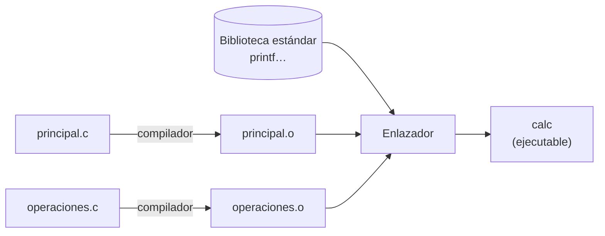
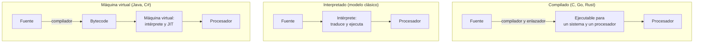
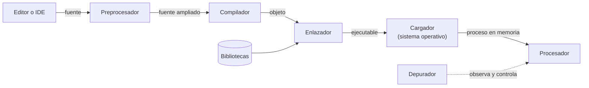
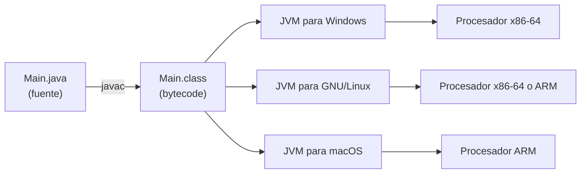
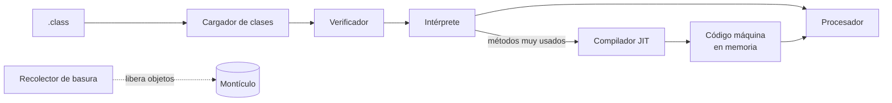
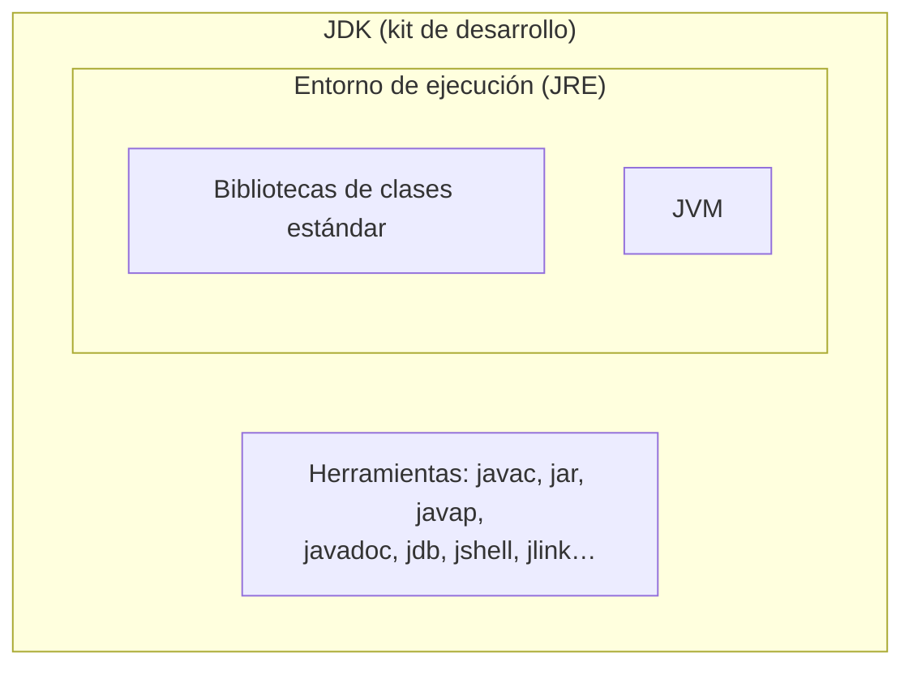
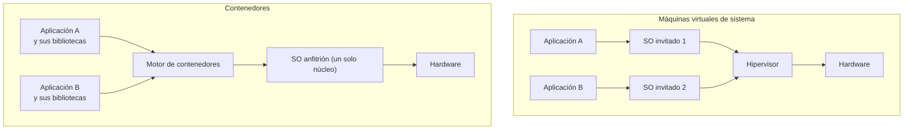
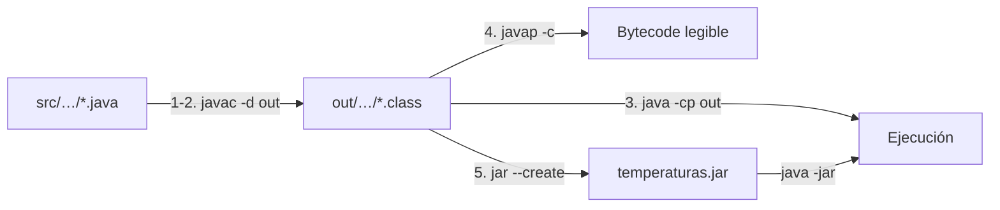

# 3. Del código fuente al ejecutable

[⬅️ Volver a la unidad](./README.md)

## Índice

- [3.1. Código fuente, objeto y ejecutable](#31-código-fuente-objeto-y-ejecutable)
  - [3.1.1. Un ejemplo en C](#311-un-ejemplo-en-c)
  - [3.1.2. El enlazador resuelve las referencias](#312-el-enlazador-resuelve-las-referencias)
- [3.2. Los traductores](#32-los-traductores)
  - [3.2.1. El compilador y sus fases](#321-el-compilador-y-sus-fases)
  - [3.2.2. El intérprete](#322-el-intérprete)
  - [3.2.3. Compilación en tiempo de ejecución (JIT)](#323-compilación-en-tiempo-de-ejecución-jit)
  - [3.2.4. Transpiladores](#324-transpiladores)
  - [3.2.5. Comparativa](#325-comparativa)
- [3.3. Las herramientas del proceso](#33-las-herramientas-del-proceso)
- [3.4. El caso de Java](#34-el-caso-de-java)
  - [3.4.1. `javac` y el *bytecode*](#341-javac-y-el-bytecode)
  - [3.4.2. Ver el *bytecode* con `javap`](#342-ver-el-bytecode-con-javap)
  - [3.4.3. La máquina virtual de Java](#343-la-máquina-virtual-de-java)
  - [3.4.4. Empaquetar con `jar`](#344-empaquetar-con-jar)
  - [3.4.5. El JDK y el entorno de ejecución](#345-el-jdk-y-el-entorno-de-ejecución)
- [3.5. Tecnologías de virtualización](#35-tecnologías-de-virtualización)
- [3.6. Errores de compilación, de ejecución y de lógica](#36-errores-de-compilación-de-ejecución-y-de-lógica)
- [3.7. Ejemplo integrador: compilar, ejecutar y empaquetar a mano](#37-ejemplo-integrador-compilar-ejecutar-y-empaquetar-a-mano)
- [Resumen](#resumen)
- [Ejercicios de reflexión](#ejercicios-de-reflexión)

> **CE que trabaja este tema:** RA1 c, d.

---

## 3.1. Código fuente, objeto y ejecutable

Una receta escrita en español no la puede seguir alguien que solo habla japonés: primero hay que traducirla. Con los programas pasa lo mismo: tú los escribes en un lenguaje de alto nivel, pero el procesador solo entiende lenguaje máquina. Por el camino, el programa pasa por tres formas:

| | Código fuente | Código objeto | Código ejecutable |
|---|---------------|---------------|-------------------|
| Qué es | Las instrucciones tal como las escribe el programador | La traducción de **un** fichero fuente a lenguaje máquina (o a un código intermedio), todavía incompleta | El programa completo, con todas sus partes unidas, listo para que el sistema operativo lo cargue y lo ejecute |
| Lenguaje | Alto nivel (Java, C, Python…) | Máquina, o intermedio (*bytecode* en Java) | Máquina |
| ¿Lo lee una persona? | Sí | No (es binario) | No (es binario) |
| ¿Se ejecuta? | No directamente | No: le faltan partes | Sí |
| Quién lo produce | El programador, con un editor o un IDE | El compilador | El enlazador |
| Ejemplos de fichero | `saludo.c`, `Main.java` | `saludo.o` (`.obj` en Windows), `Main.class` | `saludo` (GNU/Linux y macOS), `saludo.exe` (Windows) |

> 💡 **Tip del Examinador**: La diferencia entre **objeto** y **ejecutable** es la que más se pregunta. El código objeto ya está traducido, pero **no está completo**: puede usar funciones que están en otros ficheros o en bibliotecas y que todavía no se han unido. El **enlazador** une todos los objetos y las bibliotecas y produce el ejecutable.

### 3.1.1. Un ejemplo en C

C es el ejemplo clásico porque cada paso deja un fichero que puedes ver. Este es el **código fuente**, `saludo.c`:

```c
#include <stdio.h>

int main(void) {
    printf("Hola desde C\n");
    return 0;
}
```

Con el compilador `gcc` (de GNU), primero se obtiene el **código objeto** (la opción `-c` dice «compila, pero no enlaces»):

```bash
gcc -c saludo.c
```

Aparece `saludo.o`, un fichero binario. Contiene la traducción de `main` a lenguaje máquina, pero **no** contiene `printf`: solo una nota que dice «aquí se llama a `printf`, que está en otra parte». Después se **enlaza** para obtener el **ejecutable**, y se ejecuta:

```bash
gcc saludo.o -o saludo
./saludo
```

```text
Hola desde C
```

El enlazador ha unido `saludo.o` con la **biblioteca estándar de C**, donde está `printf`.

### 3.1.2. El enlazador resuelve las referencias

Un programa real tiene muchos ficheros fuente. Aquí hay dos: `operaciones.c` define una función, y `principal.c` la usa.

```c
// operaciones.c
int sumar(int a, int b) {
    return a + b;
}
```

```c
// principal.c
#include <stdio.h>

int sumar(int a, int b);

int main(void) {
    printf("2 + 3 = %d\n", sumar(2, 3));
    return 0;
}
```

Cada fichero se compila por separado a su propio código objeto. Si intentas enlazar solo `principal.o`, el enlazador no encuentra `sumar`:

```bash
gcc -c principal.c operaciones.c
gcc principal.o -o calc
```

```text
/usr/bin/ld: principal.o: in function `main':
principal.c:(.text+0x13): undefined reference to `sumar'
collect2: error: ld returned 1 exit status
```

El error no es del compilador (`principal.c` era correcto), sino del **enlazador** (`ld`; la ruta exacta que aparece al principio depende del sistema): «referencia sin definir» (*undefined reference*). Al enlazar los dos objetos, funciona:

```bash
gcc principal.o operaciones.o -o calc
./calc
```

```text
2 + 3 = 5
```



El diagrama muestra que cada fuente se compila por separado y que el ejecutable solo aparece cuando el enlazador junta todos los objetos y las bibliotecas.

El enlace puede ser de dos tipos:

- **Estático**: el código de las bibliotecas se **copia** dentro del ejecutable. El ejecutable es más grande, pero no depende de nada externo.
- **Dinámico**: el ejecutable solo guarda una referencia, y la biblioteca (`.dll` en Windows, `.so` en GNU/Linux, `.dylib` en macOS) se carga **al ejecutarlo**. Los ejecutables son más pequeños y varios programas comparten la misma biblioteca en memoria, pero si falta la biblioteca el programa no arranca. Es lo habitual.

---

## 3.2. Los traductores

Un **traductor** (*translator*) es un programa que convierte un programa escrito en un lenguaje en otro equivalente escrito en otro lenguaje. Hay varias formas de hacerlo.

### 3.2.1. El compilador y sus fases

Un **compilador** (*compiler*) traduce **todo** el programa fuente **antes** de ejecutarlo y genera código objeto. Por dentro trabaja en fases. Mira cómo trataría la línea `total = precio * 2;`:

| Fase | Qué hace | En el ejemplo |
|------|----------|---------------|
| **Análisis léxico** | Lee los caracteres y los agrupa en **componentes léxicos** (*tokens*), quitando espacios y comentarios | `total` (identificador), `=` (asignación), `precio` (identificador), `*` (operador), `2` (número), `;` (fin de sentencia) |
| **Análisis sintáctico** | Comprueba que los *tokens* siguen la gramática del lenguaje y construye el **árbol sintáctico** | Es una asignación: a la izquierda `total`, a la derecha la multiplicación `precio * 2` |
| **Análisis semántico** | Comprueba que lo que dice tiene sentido: que las variables existen y que los tipos encajan | `total` y `precio` están declaradas y el resultado de multiplicar cabe en `total` |
| **Generación de código intermedio** | Traduce el árbol a una representación sencilla e independiente del procesador | `t1 = precio * 2` y `total = t1` |
| **Optimización** | Mejora el código intermedio para que ocupe menos o vaya más rápido | Por ejemplo, cambia `precio * 2` por una suma o un desplazamiento, que son más rápidos |
| **Generación de código** | Produce el código final para el procesador de destino | Las instrucciones de máquina |


Las tres primeras fases forman el **análisis** (comprueban que el programa es correcto); las tres últimas, la **síntesis** (producen el código). Si el análisis encuentra un error, el compilador lo informa con la línea y no genera nada.

### 3.2.2. El intérprete

Un **intérprete** (*interpreter*) no genera un ejecutable: lee el programa y lo **ejecuta directamente**, traduciendo cada instrucción mientras avanza. Es el modelo clásico, el de los primeros BASIC o el de Bash.

| Ventajas | Inconvenientes |
|----------|----------------|
| Se ejecuta en cuanto se escribe, sin esperar a compilar | Más lento: se traduce cada vez que se ejecuta, y las instrucciones de un bucle, en cada vuelta |
| El mismo programa funciona en cualquier sistema que tenga el intérprete | Hace falta tener el intérprete instalado para ejecutarlo |
| Facilita probar y depurar poco a poco | Muchos errores no se descubren hasta que se ejecuta la línea que los tiene |

> ⚠️ **Cuidado**: Los intérpretes actuales casi nunca traducen «línea a línea» de forma pura. **CPython**, el intérprete habitual de Python, primero **compila** el programa a un *bytecode* propio y después lo ejecuta en su máquina virtual; de los módulos que importas, guarda ese *bytecode* en ficheros `.pyc` dentro de una carpeta `__pycache__`. Por eso un error de sintaxis en la última línea de un programa de Python impide ejecutar incluso la primera.

### 3.2.3. Compilación en tiempo de ejecución (JIT)

La **compilación en tiempo de ejecución** (*just-in-time compilation*, **JIT**) combina las dos ideas: el programa empieza ejecutándose **interpretado**, mientras el sistema observa qué partes se ejecutan más (los **puntos calientes**, *hot spots*). Esas partes las **compila a código máquina** en ese momento y, a partir de ahí, ejecuta directamente la versión compilada.

Así se consigue arrancar rápido (no hay que compilar todo antes) y, a la vez, ejecutar rápido el código que más importa. Usan JIT la máquina virtual de Java, el CLR de .NET y los motores de JavaScript de los navegadores (como V8 en Chrome).

### 3.2.4. Transpiladores

Un **transpilador** (*transpiler* o *source-to-source compiler*) traduce de un lenguaje de **alto nivel** a **otro de alto nivel**. El caso más conocido es **TypeScript**, que se transpila a JavaScript para que lo ejecute un navegador. El **ensamblador** (*assembler*), al revés, traduce de ensamblador a lenguaje máquina.

### 3.2.5. Comparativa



El diagrama compara los tres caminos: en el compilado la traducción se hace una vez antes de ejecutar; en el interpretado, durante la ejecución; y con máquina virtual, en dos pasos.

| | Compilado | Interpretado | Máquina virtual con JIT |
|---|-----------|--------------|-------------------------|
| Cuándo se traduce | Antes de ejecutar, una vez | Durante la ejecución, cada vez | A *bytecode* antes; a máquina, durante la ejecución |
| Qué se distribuye | El ejecutable | El código fuente | El *bytecode* (`.class`, `.jar`) |
| Velocidad de ejecución | La más alta | La más baja | Alta, tras calentarse |
| Portabilidad | Hay que compilar para cada sistema y procesador | Cualquier sistema con el intérprete | Cualquier sistema con la máquina virtual |
| Errores de sintaxis y de tipos | Se detectan al compilar | Se detectan al ejecutar | Se detectan al compilar a *bytecode* |
| Ejemplos | C, C++, Go, Rust | Bash; Python y JavaScript, con matices | Java, Kotlin, C# |

---

## 3.3. Las herramientas del proceso

Para obtener un ejecutable a partir del código fuente, y para ejecutarlo, intervienen varias herramientas. No todas aparecen en todos los lenguajes:



El diagrama muestra la cadena completa en un lenguaje compilado como C: cada herramienta recibe lo que produce la anterior.

| Herramienta | Qué hace | Ejemplos |
|-------------|----------|----------|
| **Editor** o **IDE** | Escribir el código fuente | VS Code, IntelliJ IDEA (UD2) |
| **Preprocesador** | Antes de compilar, procesa las **directivas**: incluye ficheros (`#include`), sustituye macros (`#define`) y quita comentarios. Existe en C y C++, no en Java | `cpp` (el de GNU) |
| **Compilador** | Traduce el fuente a código objeto o a *bytecode* | `gcc`, `javac` |
| **Ensamblador** | Traduce ensamblador a lenguaje máquina (muchos compiladores lo usan internamente) | `as` |
| **Enlazador** (*linker*) | Une los códigos objeto y las bibliotecas en un ejecutable y resuelve las referencias entre ellos | `ld` |
| **Cargador** (*loader*) | Parte del sistema operativo que copia el ejecutable a la memoria y lo prepara para ejecutarse ([tema 1](./01-programas-y-sistema.md)) | El del propio sistema operativo |
| **Intérprete** o **máquina virtual** | Ejecuta el programa sin generar un ejecutable nativo | `python`, la JVM |
| **Depurador** (*debugger*) | Ejecuta el programa bajo control: lo detiene en un punto (**punto de ruptura**, *breakpoint*), avanza instrucción a instrucción y muestra o cambia el valor de las variables | `gdb`, `jdb`, el depurador del IDE (UD4) |

> 📝 **Nota del Profesor**: El **depurador** no traduce nada, pero forma parte del proceso porque sirve para encontrar los errores que el compilador no ve, los de ejecución y los de lógica. En la UD2 lo usarás por primera vez desde el IDE, y en la UD4 lo aprenderás a fondo.

---

## 3.4. El caso de Java

Java se diseñó para que un programa compilado funcionara **sin cambios** en cualquier sistema: «escribe una vez, ejecuta en cualquier parte» (*write once, run anywhere*). Para conseguirlo, no se compila a lenguaje máquina de un procesador concreto, sino a un **código intermedio**: el ***bytecode***.



El diagrama muestra la idea central de Java: **un solo** `.class` y **una JVM distinta** para cada sistema, que es la que lo traduce al lenguaje máquina de cada procesador.

### 3.4.1. `javac` y el *bytecode*

El compilador de Java, `javac`, traduce cada clase del código fuente (`.java`) a un fichero `.class` con su *bytecode*. El *bytecode* es el **código objeto** de Java: un lenguaje máquina, pero de una máquina que no existe físicamente, la **máquina virtual de Java** (*Java Virtual Machine*, **JVM**).

```bash
javac -d out src/endes/temperaturas/Conversor.java src/endes/temperaturas/Main.java
```

La opción `-d out` dice dónde dejar los `.class`; `javac` crea las carpetas de los paquetes:

```text
out/endes/temperaturas/Conversor.class
out/endes/temperaturas/Main.class
```

Todos los ficheros `.class` empiezan por los mismos cuatro bytes, `CA FE BA BE`, seguidos de la **versión** del formato. Si miras con un visor hexadecimal un `.class` compilado con Java 17, verás:

```text
ca fe ba be 00 00 00 3d ...
```

`3d` en hexadecimal es 61: la versión del formato de Java 17. Cada versión de Java tiene la suya: 65 (`41`) en Java 21 y 69 (`45`) en Java 25, por ejemplo. Una JVM más antigua se niega a cargar un `.class` de una versión posterior a la suya, con un error `UnsupportedClassVersionError`.

### 3.4.2. Ver el *bytecode* con `javap`

`javap` es el **desensamblador** del JDK: con la opción `-c` muestra el *bytecode* de cada método en un formato legible. Para esta clase:

```java
package endes.temperaturas;

/**
 * Conversiones entre escalas de temperatura.
 */
public class Conversor {

    /**
     * Convierte grados Celsius a grados Fahrenheit.
     *
     * @param celsius temperatura en grados Celsius
     * @return temperatura en grados Fahrenheit
     */
    public static double aFahrenheit(double celsius) {
        return celsius * 9 / 5 + 32;
    }
}
```

```bash
javap -c -cp out endes.temperaturas.Conversor
```

```text
Compiled from "Conversor.java"
public class endes.temperaturas.Conversor {
  public endes.temperaturas.Conversor();
    Code:
       0: aload_0
       1: invokespecial #1                  // Method java/lang/Object."<init>":()V
       4: return

  public static double aFahrenheit(double);
    Code:
       0: dload_0
       1: ldc2_w        #7                  // double 9.0d
       4: dmul
       5: ldc2_w        #9                  // double 5.0d
       8: ddiv
       9: ldc2_w        #11                 // double 32.0d
      12: dadd
      13: dreturn
}
```

Es la salida con Java 17; con otras versiones puede cambiar el espaciado o algún número de la columna `#`, pero las instrucciones son las mismas.

Cómo se lee `aFahrenheit`: la JVM es una **máquina de pila**. `dload_0` pone en la pila el parámetro `celsius`; `ldc2_w` pone la constante 9.0; `dmul` saca los dos valores, los multiplica y deja el resultado; y así con la división (`ddiv`) y la suma (`dadd`). `dreturn` devuelve lo que queda en la pila. La `d` inicial de cada instrucción indica que trabaja con `double`.

Fíjate también en dos cosas:

- Aparece un constructor `Conversor()` que no escribiste: `javac` lo añade si la clase no tiene ninguno (es el **constructor por defecto**).
- El *bytecode* se parece al ensamblador del [tema 2](./02-lenguajes-de-programacion.md): instrucciones sencillas, una por línea. Es de bajo nivel, pero **no depende de ningún procesador real**.

### 3.4.3. La máquina virtual de Java

La JVM es un programa (escrito para cada sistema operativo y procesador) que ejecuta *bytecode*. La más usada es **HotSpot**, la de OpenJDK. Al ejecutar `java -cp out endes.temperaturas.Main`, la JVM:

1. **Carga las clases** que se necesitan, cuando se necesitan: primero `Main`, y `Conversor` la primera vez que se usa. Lo hace el **cargador de clases** (*class loader*), que las busca en la ruta de clases (*classpath*, la opción `-cp`).
2. **Verifica** el *bytecode*: comprueba que es correcto y seguro (que no salta a cualquier sitio ni mezcla tipos) antes de ejecutarlo.
3. **Ejecuta** el *bytecode* con su **intérprete** y, a la vez, cuenta cuántas veces se ejecuta cada método.
4. **Compila con JIT** a código máquina los métodos que más se ejecutan, y a partir de ahí usa esa versión. HotSpot tiene dos compiladores JIT: uno rápido que compila pronto y otro que tarda más pero optimiza mucho los métodos muy usados.
5. **Gestiona la memoria**: reserva la pila de cada hilo y el montículo donde van los objetos, y el **recolector de basura** (*garbage collector*) libera los objetos que ya nadie usa ([tema 1](./01-programas-y-sistema.md)).



El diagrama muestra el recorrido de una clase dentro de la JVM: lo que más se ejecuta acaba convertido en código máquina.

> ⚠️ **Cuidado**: Decir que «Java es interpretado» es **incompleto**: la JVM interpreta el *bytecode* al principio, pero compila a código máquina las partes que más se ejecutan. Por eso un programa Java va más lento justo al arrancar (se está «calentando») y luego alcanza una velocidad cercana a la de un programa compilado a máquina.

La JVM no es exclusiva de Java: **Kotlin**, **Scala** o **Groovy** también se compilan a *bytecode* y se ejecutan en ella. Y Java no es el único lenguaje con máquina virtual: los lenguajes de **.NET** (C#, F#) se compilan a un código intermedio que ejecuta el **CLR** (*Common Language Runtime*), también con JIT.

> 📝 **Nota del Profesor** (**Ampliación**): También se puede compilar Java **antes** de ejecutar (*ahead-of-time*, **AOT**) a un ejecutable nativo, con herramientas como GraalVM Native Image. Arranca mucho más rápido y ocupa menos memoria, pero el ejecutable vuelve a depender del sistema y del procesador. Se usa sobre todo en servicios en la nube.

### 3.4.4. Empaquetar con `jar`

Un programa Java real tiene decenas o cientos de `.class`. Para distribuirlo se empaquetan en un **fichero JAR** (*Java ARchive*): un fichero comprimido en formato ZIP con los `.class`, otros recursos (imágenes, configuración) y un fichero de descripción, el **manifiesto** (`META-INF/MANIFEST.MF`).

```bash
jar --create --file temperaturas.jar --main-class endes.temperaturas.Main -C out .
```

- `--create --file temperaturas.jar`: crea el fichero JAR con ese nombre.
- `--main-class endes.temperaturas.Main`: escribe en el manifiesto qué clase tiene el `main`. Así el JAR es **ejecutable**.
- `-C out .`: entra en la carpeta `out` y mete todo su contenido.

```bash
jar --list --file temperaturas.jar
```

```text
META-INF/
META-INF/MANIFEST.MF
endes/
endes/temperaturas/
endes/temperaturas/Conversor.class
endes/temperaturas/Main.class
```

El manifiesto que ha generado `jar` contiene (la segunda línea depende de tu JDK y de quién lo distribuye):

```text
Manifest-Version: 1.0
Created-By: <versión del JDK> (<distribuidor del JDK>)
Main-Class: endes.temperaturas.Main
```

Y se ejecuta con `java -jar`, sin indicar la clase:

```bash
java -jar temperaturas.jar
```

> 💡 **Tip del Examinador**: Un JAR **no** es un ejecutable nativo como un `.exe`: contiene *bytecode* y necesita una JVM para ejecutarse. Su ventaja es la contraria: el mismo `temperaturas.jar` funciona en Windows, GNU/Linux y macOS.

### 3.4.5. El JDK y el entorno de ejecución

Para **ejecutar** programas Java basta con un **entorno de ejecución** (*Java Runtime Environment*, **JRE**): la JVM y las **bibliotecas de clases** estándar (`String`, `Scanner`, las colecciones…). Para **desarrollarlos** hace falta el **kit de desarrollo** (*Java Development Kit*, **JDK**), que incluye el entorno de ejecución y además las herramientas de desarrollo.

| Herramienta del JDK | Para qué sirve |
|---------------------|----------------|
| `javac` | Compilar el código fuente a *bytecode* |
| `java` | Ejecutar un programa (lanza la JVM) |
| `jar` | Empaquetar y desempaquetar ficheros JAR |
| `javap` | Desensamblar un `.class` para ver su *bytecode* |
| `javadoc` | Generar la documentación a partir de los comentarios (UD5) |
| `jdb` | Depurar desde la terminal |
| `jshell` | Probar instrucciones de Java sueltas, de forma interactiva |
| `jlink` | Crear un entorno de ejecución a medida, solo con los módulos que necesita un programa |



El diagrama muestra que el entorno de ejecución está **dentro** del JDK: quien tiene el JDK puede compilar y ejecutar; quien solo tiene el entorno de ejecución, solo ejecutar.

Desde Java 11, Oracle ya no distribuye un JRE separado: se descarga el JDK, y para distribuir una aplicación se crea un entorno de ejecución a medida con `jlink`. Algunas distribuciones de OpenJDK, como **Eclipse Temurin**, siguen ofreciendo también un JRE para quien solo necesita ejecutar.

> 📝 **Nota del Profesor**: En este módulo usarás **el mismo JDK que tienes instalado para Programación**, sea de la distribución que sea, siempre que su versión sea la 17 o posterior. No instales otro: dos JDK en el mismo equipo pueden hacer que `java` y `javac` respondan con versiones distintas y estropear la instalación que usas en Programación.

> ⚠️ **Cuidado**: Si en un equipo `java -version` funciona pero `javac` dice «orden no encontrada», es que solo tiene instalado un **entorno de ejecución**, no un JDK: puede ejecutar programas Java, pero no compilarlos.

---

## 3.5. Tecnologías de virtualización

**Virtualizar** es crear una versión **simulada** de un recurso (un procesador, un ordenador entero, un sistema operativo) que se comporta como el real. La JVM es un ejemplo, pero hay más tipos:

**Máquinas virtuales de proceso** (*process virtual machines*). Ejecutan **un programa** sobre un procesador «inventado»: la JVM, el CLR de .NET o la máquina virtual de Python. Se crean al lanzar el programa y desaparecen cuando termina. Sirven para que el programa sea **portable**.

**Máquinas virtuales de sistema** (*system virtual machines*). Simulan un **ordenador completo** (procesador, memoria, disco, red) en el que se instala un sistema operativo entero, el **invitado** (*guest*), dentro de otro, el **anfitrión** (*host*). Las gestiona un **hipervisor** (*hypervisor*):

- **De tipo 1** (*bare-metal*): se ejecuta directamente sobre el hardware, sin sistema operativo anfitrión. Es lo que se usa en los servidores y en la nube. Ejemplos: VMware ESXi, Microsoft Hyper-V, KVM (en el núcleo de Linux), Proxmox VE.
- **De tipo 2** (*hosted*): es un programa más del sistema operativo anfitrión. Es lo habitual en un ordenador personal. Ejemplos: Oracle VirtualBox, VMware Workstation.

**Contenedores** (*containers*). En lugar de simular un ordenador entero, **aíslan** un programa con todo lo que necesita (bibliotecas, configuración, herramientas) pero **compartiendo el núcleo** del sistema operativo anfitrión. Arrancan en segundos y ocupan mucho menos que una máquina virtual. La herramienta más conocida es **Docker**: una **imagen** es la plantilla (por ejemplo, «Ubuntu con el JDK 25 y Maven»), y un **contenedor** es una ejecución de esa imagen.



El diagrama compara las capas: cada máquina virtual lleva su propio sistema operativo completo, mientras que los contenedores comparten el núcleo del anfitrión.

| | Máquina virtual de proceso | Máquina virtual de sistema | Contenedor |
|---|---------------------------|----------------------------|------------|
| Qué virtualiza | Un procesador para un programa | Un ordenador completo | El entorno de un programa |
| Lleva sistema operativo propio | No | Sí, completo | No: comparte el núcleo del anfitrión |
| Arranque | Instantáneo | Minutos | Segundos |
| Tamaño | Pequeño | Gigabytes | Decenas o cientos de megabytes |
| Aislamiento | El del programa | Muy alto | Alto, pero menor que una máquina virtual |
| Ejemplos | JVM, CLR | VirtualBox, Hyper-V, KVM | Docker, Podman |

**Para qué sirven en el desarrollo de software:**

- **Portabilidad**: con una máquina virtual de proceso, el mismo programa funciona en cualquier sistema (Java).
- **Probar en otros sistemas**: con una máquina virtual de sistema puedes probar tu aplicación en Windows, GNU/Linux o una versión antigua de un sistema sin cambiar de ordenador.
- **Entornos reproducibles**: con un contenedor, todo el equipo (y el servidor de integración continua) trabaja con exactamente las mismas versiones de las herramientas. Se acabó el «en mi equipo funciona».
- **Desplegar**: las aplicaciones se publican en servidores y en la nube como contenedores o máquinas virtuales.

> 📝 **Nota del Profesor**: Las soluciones de los ejercicios de este curso se comprueban en un **contenedor de Docker** con Java 17, la versión mínima del curso. Así, si una solución funciona en el contenedor, funciona en cualquier equipo con Java 17 o posterior, sin depender de lo que tenga instalado el profesor.

---

## 3.6. Errores de compilación, de ejecución y de lógica

Saber **en qué momento** aparece un error ayuda a entender el proceso de traducción y a corregirlo antes.

**Errores de compilación.** Los detecta el compilador al analizar el código: no se genera el `.class` y el programa no se puede ejecutar. Pueden ser **sintácticos** (no se respeta la gramática) o **semánticos** (la frase es correcta, pero no tiene sentido: una variable que no existe, tipos que no encajan).

```java
public class Error1 {
    public static void main(String[] args) {
        int total = 10
        System.out.println(total);
    }
}
```

```text
Error1.java:3: error: ';' expected
        int total = 10
                      ^
1 error
```

Es un error **sintáctico**: falta el punto y coma. El compilador dice el fichero, la **línea** (3), qué esperaba y, con `^`, dónde.

```java
public class Error3 {
    public static void main(String[] args) {
        Strin nombre = "Ana";
        System.out.println(nombre);
    }
}
```

```text
Error3.java:3: error: cannot find symbol
        Strin nombre = "Ana";
        ^
  symbol:   class Strin
  location: class Error3
1 error
```

Es un error **semántico**: la frase está bien construida, pero no existe ninguna clase `Strin`.

**Errores de ejecución.** El programa compila, pero falla **al ejecutarse**, cuando llega a una operación imposible. En Java aparecen como una **excepción** (*exception*) que detiene el programa y muestra la **traza** (*stack trace*): qué pasó y en qué línea.

```java
public class Error2 {
    public static void main(String[] args) {
        int alumnos = 0;
        int puntos = 100;
        System.out.println("Media: " + puntos / alumnos);
    }
}
```

```text
Exception in thread "main" java.lang.ArithmeticException: / by zero
	at Error2.main(Error2.java:5)
```

El compilador no puede saber que `alumnos` valdrá 0: solo se descubre al ejecutar.

**Errores de lógica.** El programa compila, se ejecuta y termina sin fallar… pero el resultado **no es el correcto**. Por ejemplo, calcular la media de 7 y 8 como `(7 + 8) / 2` con enteros da 7, no 7,5, porque la división entre enteros descarta los decimales. Ni el compilador ni la JVM avisan: solo se detectan **probando** el programa (UD4).

| Tipo | Quién lo detecta | Cuándo | Ejemplo |
|------|------------------|--------|---------|
| De compilación sintáctico | Compilador | Al compilar | Falta un `;` o una llave |
| De compilación semántico | Compilador | Al compilar | Variable sin declarar, tipos incompatibles |
| De enlace | Enlazador (en C) | Al enlazar | Función usada pero no definida |
| De ejecución | La JVM o el sistema operativo | Al ejecutar | División entre cero, posición inexistente de un array |
| De lógica | Las pruebas | Al probar | Resultado incorrecto sin ningún aviso |

> ✅ **Buena práctica**: Lee **siempre** el primer mensaje de error de arriba abajo: el fichero, la línea y el texto. A menudo un solo error provoca otros en cascada, y al corregir el primero desaparecen los demás.

---

## 3.7. Ejemplo integrador: compilar, ejecutar y empaquetar a mano

Vas a juntar todo lo del tema con un programa de dos clases: `Conversor` (la del apartado 3.4.2) y `Main`, que muestra una tabla de temperaturas. La estructura de carpetas sigue el paquete `endes.temperaturas`:

```text
temperaturas/
└── src/
    └── endes/
        └── temperaturas/
            ├── Conversor.java
            └── Main.java
```

```java
package endes.temperaturas;

/**
 * Muestra una tabla de conversión de grados Celsius a Fahrenheit.
 */
public class Main {

    public static void main(String[] args) {
        for (int celsius = 0; celsius <= 40; celsius += 10) {
            System.out.println(celsius + " °C = " + Conversor.aFahrenheit(celsius) + " °F");
        }
    }
}
```

Desde la carpeta `temperaturas`, en la terminal:

**1. Comprobar que tienes un JDK.** Las dos órdenes deben responder con la misma versión:

```bash
java -version
javac -version
```

**2. Compilar** las dos clases a *bytecode*:

```bash
javac -d out src/endes/temperaturas/*.java
```

No muestra nada si todo va bien. En `out/endes/temperaturas/` aparecen `Conversor.class` y `Main.class`.

**3. Ejecutar** indicando la ruta de clases y el nombre completo de la clase con `main`:

```bash
java -cp out endes.temperaturas.Main
```

```text
0 °C = 32.0 °F
10 °C = 50.0 °F
20 °C = 68.0 °F
30 °C = 86.0 °F
40 °C = 104.0 °F
```

**4. Ver el *bytecode*** de `Conversor`, como en el apartado 3.4.2:

```bash
javap -c -cp out endes.temperaturas.Conversor
```

**5. Empaquetar** en un JAR ejecutable y **ejecutarlo**:

```bash
jar --create --file temperaturas.jar --main-class endes.temperaturas.Main -C out .
java -jar temperaturas.jar
```

La salida es la misma tabla. Si copias `temperaturas.jar` a otro equipo con otro sistema operativo y una JVM de la misma versión o posterior, funciona igual.



El diagrama resume las órdenes del ejemplo: todo parte de los `.class` que genera `javac`.

> 📝 **Nota del Profesor**: En la UD2 harás todo esto con un clic desde el IDE y con Maven. Pero el IDE y Maven ejecutan por debajo estas mismas herramientas: si sabes hacerlo a mano, entenderás qué falla cuando algo no funciona. Es lo que practicarás en el ejercicio E02.

---

## Resumen

- **Código fuente**: lo que escribe el programador, en alto nivel. **Código objeto**: la traducción de cada fichero fuente, todavía incompleta. **Código ejecutable**: el programa completo, enlazado y listo para cargarse.
- El **compilador** traduce todo antes de ejecutar, en fases: análisis léxico, sintáctico y semántico, y código intermedio, optimización y generación de código. El **enlazador** une los objetos y las bibliotecas (enlace estático o dinámico).
- El **intérprete** traduce y ejecuta a la vez. Los actuales combinan técnicas: CPython compila a *bytecode*, y la JVM y los motores de JavaScript usan **compilación JIT**. Un **transpilador** traduce entre lenguajes de alto nivel.
- Herramientas del proceso: editor o IDE, preprocesador, compilador, ensamblador, enlazador, cargador, intérprete o máquina virtual y **depurador**.
- Java compila con `javac` a ***bytecode*** (`.class`), que ejecuta la **JVM**: carga las clases, las verifica, las interpreta y compila con JIT lo que más se usa, y gestiona la memoria con el recolector de basura. `javap -c` muestra el *bytecode*; `jar` empaqueta los `.class` en un JAR con su manifiesto.
- El **JDK** incluye el entorno de ejecución (JVM y bibliotecas) y las herramientas de desarrollo.
- Virtualización: **máquinas virtuales de proceso** (JVM, CLR), **de sistema** (con hipervisor de tipo 1 o 2) y **contenedores** (Docker), que comparten el núcleo del anfitrión.
- Errores **de compilación** (sintácticos y semánticos), **de enlace**, **de ejecución** (excepciones) y **de lógica** (solo los descubren las pruebas).

## Ejercicios de reflexión

1. ¿Por qué el código objeto no se puede ejecutar directamente? Explícalo con el ejemplo de `principal.c` y `operaciones.c`.
2. Un compañero dice que Java es lento porque es interpretado. ¿Qué le responderías?
3. Si distribuyes un programa en C para Windows, GNU/Linux y macOS, ¿cuántos ejecutables necesitas? ¿Y si lo escribes en Java? ¿Qué necesita tener instalado el usuario en cada caso?
4. ¿Qué usarías para probar tu aplicación en una versión antigua de Windows sin tener ese ordenador: una máquina virtual de sistema o un contenedor? ¿Por qué?

---

[⬅️ Volver a la unidad](./README.md)
