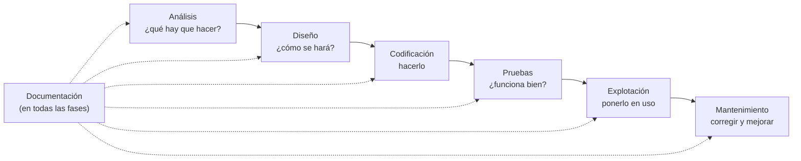
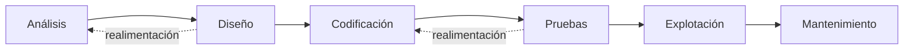
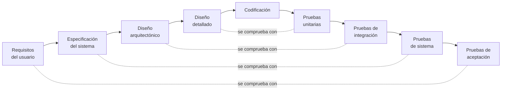
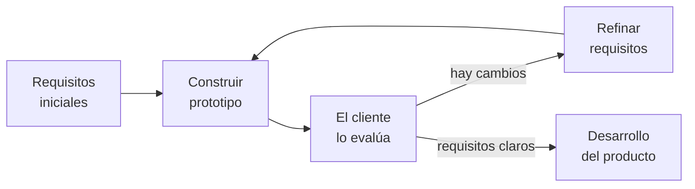
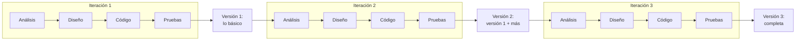
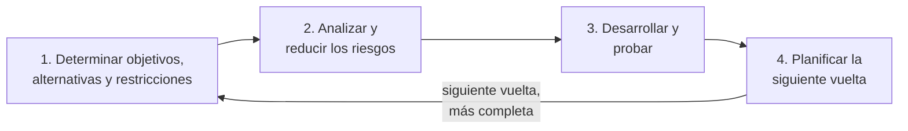

# 4. Fases del desarrollo y ciclo de vida

[⬅️ Volver a la unidad](./README.md)

## Índice

- [4.1. La ingeniería del software](#41-la-ingeniería-del-software)
  - [4.1.1. La crisis del software](#411-la-crisis-del-software)
  - [4.1.2. Qué es la ingeniería del software](#412-qué-es-la-ingeniería-del-software)
- [4.2. Las fases del desarrollo](#42-las-fases-del-desarrollo)
  - [4.2.1. Análisis](#421-análisis)
  - [4.2.2. Diseño](#422-diseño)
  - [4.2.3. Codificación](#423-codificación)
  - [4.2.4. Pruebas](#424-pruebas)
  - [4.2.5. Documentación](#425-documentación)
  - [4.2.6. Explotación](#426-explotación)
  - [4.2.7. Mantenimiento](#427-mantenimiento)
  - [4.2.8. Qué sale de cada fase](#428-qué-sale-de-cada-fase)
- [4.3. Modelos de ciclo de vida](#43-modelos-de-ciclo-de-vida)
  - [4.3.1. En cascada](#431-en-cascada)
  - [4.3.2. En V](#432-en-v)
  - [4.3.3. De prototipos](#433-de-prototipos)
  - [4.3.4. Iterativo e incremental](#434-iterativo-e-incremental)
  - [4.3.5. En espiral](#435-en-espiral)
  - [4.3.6. Cómo elegir un modelo](#436-cómo-elegir-un-modelo)
- [4.4. Ejemplo integrador: una aplicación para pedir cita en un taller](#44-ejemplo-integrador-una-aplicación-para-pedir-cita-en-un-taller)
- [Resumen](#resumen)
- [Ejercicios de reflexión](#ejercicios-de-reflexión)

> **CE que trabaja este tema:** RA1 b.

---

## 4.1. La ingeniería del software

Para construir una caseta en el jardín basta con unas tablas y un fin de semana. Para construir un edificio de diez plantas hacen falta planos, cálculos, permisos, un plan de obra y un equipo coordinado. Con el software pasa lo mismo: un programa de cien líneas se escribe «sobre la marcha», pero una aplicación de millones de líneas, hecha por decenas de personas durante años, necesita **método**.

### 4.1.1. La crisis del software

En los años sesenta los ordenadores se volvieron mucho más potentes y empezaron a encargarse programas cada vez más grandes. Los proyectos se retrasaban, costaban mucho más de lo previsto, se entregaban con errores y eran muy difíciles de modificar. A ese problema se le llamó **crisis del software** (*software crisis*).

El término se popularizó en la **conferencia sobre ingeniería del software** que organizó la OTAN en 1968, en Garmisch (Alemania), donde también se propuso tratar el desarrollo de software como una **ingeniería**. Edsger W. Dijkstra lo difundió después en su conferencia del Premio Turing de 1972.

### 4.1.2. Qué es la ingeniería del software

La **ingeniería del software** (*software engineering*) es la aplicación de un enfoque **sistemático, disciplinado y medible** al desarrollo, la explotación y el mantenimiento del software. En la práctica, significa:

- Seguir un **proceso** con fases y resultados definidos, en lugar de improvisar.
- Usar **métodos** y **herramientas** probados para cada actividad.
- **Medir** (plazos, costes, defectos) para planificar y mejorar.
- Cuidar la **calidad** desde el principio, no solo al final.

El conocimiento de la profesión lo recoge la **SWEBOK** (*Guide to the Software Engineering Body of Knowledge*), una guía del IEEE Computer Society. Su versión 4 (2024) organiza la ingeniería del software en áreas de conocimiento como los requisitos, la arquitectura, el diseño, la construcción, las pruebas, las **operaciones**, el mantenimiento, la gestión de la configuración, la gestión del proyecto, los procesos, la calidad y la **seguridad**, e integra los enfoques ágiles y DevOps ([tema 5](./05-metodologias-agiles.md)). Los procesos del ciclo de vida del software también están normalizados, en la norma internacional **ISO/IEC/IEEE 12207**.

> 📝 **Nota del Profesor**: No hace falta que memorices las áreas de la SWEBOK. Lo importante es la idea: el software se **construye con un proceso**, igual que un puente. Este módulo te enseña las herramientas de ese proceso: el IDE (UD2), el control de versiones (UD3), las pruebas (UD4), la calidad y la documentación (UD5) y el modelado (UD6 y UD7).

---

## 4.2. Las fases del desarrollo

El **ciclo de vida del software** (*software life cycle*) es todo lo que le pasa a una aplicación desde que alguien tiene la idea hasta que deja de usarse. Se divide en **fases**, y cada una responde a una pregunta y produce unos **resultados** (documentos, código, versiones) que usan las siguientes.

El diagrama muestra las fases en su orden lógico; la documentación no es una fase más al final, sino algo que se hace a lo largo de todas.

### 4.2.1. Análisis

**Pregunta: ¿qué tiene que hacer la aplicación?** Es la fase más importante: un error aquí se arrastra a todas las demás y es el más caro de corregir.

Actividades:

- **Obtener los requisitos** hablando con el cliente y los futuros usuarios: entrevistas, cuestionarios, observación del trabajo actual, revisión de documentos, reuniones.
- **Clasificarlos**:
  - **Requisitos funcionales**: **qué** debe hacer el sistema. «El cliente puede reservar una cita eligiendo día y hora».
  - **Requisitos no funcionales**: **cómo** debe ser el sistema (calidad y restricciones): rendimiento, seguridad, usabilidad, compatibilidad, normativa. «La página de reservas carga en menos de dos segundos», «los datos personales cumplen el Reglamento General de Protección de Datos».
- Estudiar la **viabilidad**: técnica (¿se puede hacer con la tecnología disponible?), económica (¿compensa lo que cuesta?) y legal y operativa (¿se puede usar en la organización y cumple la ley?).
- **Especificar y validar**: escribir los requisitos de forma clara, sin ambigüedad y verificable, y que el cliente confirme que es lo que quiere.

**Resultado**: la **especificación de requisitos del software** (ERS, en inglés *SRS*). Puede ir acompañada de bocetos de las pantallas o de un prototipo.

> ⚠️ **Cuidado**: Un requisito tiene que poder **comprobarse**. «La aplicación debe ser rápida» no sirve: ¿rápida cuánto? «Las búsquedas responden en menos de un segundo con mil usuarios conectados» sí se puede comprobar en la fase de pruebas.

### 4.2.2. Diseño

**Pregunta: ¿cómo se va a construir?** Se decide la solución técnica que cumplirá los requisitos, todavía sin programar.

- **Diseño arquitectónico** (de alto nivel): la estructura general del sistema. Qué partes tiene (por ejemplo, una aplicación móvil, un servidor y una base de datos), cómo se comunican y con qué tecnologías se hará cada una.
- **Diseño detallado**: cada parte por dentro. Clases y sus relaciones, estructura de la base de datos, algoritmos importantes, diseño de las pantallas y de las interfaces entre módulos.

**Resultado**: el **documento de diseño**, con diagramas (de arquitectura, de clases, de secuencia… en UML, que verás en la UD6 y la UD7), el modelo de datos y los prototipos de la interfaz.

### 4.2.3. Codificación

**Pregunta: ¿cómo se escribe?** Se **programa** lo diseñado, en el lenguaje elegido.

- Se reparte el trabajo entre los programadores.
- Se siguen unas **normas de estilo** comunes y buenas prácticas, para que el código de todos se lea igual (UD2 y UD5).
- Se usa el **control de versiones** para guardar la historia del código y trabajar en equipo sin pisarse (UD3).
- Cada programador prueba su parte mientras la escribe (**pruebas unitarias**).

**Resultado**: el **código fuente**, en un repositorio, y los **ejecutables** que se generan a partir de él ([tema 3](./03-del-codigo-al-ejecutable.md)).

### 4.2.4. Pruebas

**Pregunta: ¿funciona bien y es lo que se pidió?** Se ejecuta el software de forma planificada para **encontrar errores** antes de que los encuentren los usuarios.

- **Verificar**: ¿se está construyendo **bien** el producto? (¿cumple la especificación?).
- **Validar**: ¿se está construyendo **el producto correcto**? (¿es lo que el cliente necesita?).

Hay pruebas de distintos **niveles**: **unitarias** (cada pieza por separado), **de integración** (las piezas juntas), **de sistema** (la aplicación completa, también los requisitos no funcionales) y **de aceptación** (el cliente comprueba que es lo que pidió). Las verás a fondo en la UD4.

**Resultado**: el **plan de pruebas**, los **casos de prueba**, los informes con los resultados y el registro de **incidencias** encontradas.

> ⚠️ **Cuidado**: Las pruebas **no** aseguran que el software no tenga errores. Como dijo Dijkstra, las pruebas pueden mostrar la **presencia** de errores, nunca su **ausencia**. Lo que hacen es encontrar todos los posibles con un esfuerzo razonable y dar confianza en que la aplicación funciona en los casos probados.

### 4.2.5. Documentación

La documentación se escribe **a lo largo de todo el proyecto**, no al final. Hay de dos tipos:

- **Documentación técnica** o **interna**, para quienes desarrollan y mantienen la aplicación: los requisitos, el diseño, los comentarios del código y la documentación generada a partir de él (UD5), cómo se construye y se despliega, el registro de cambios.
- **Documentación de usuario** o **externa**: el **manual de usuario**, la ayuda en línea, las preguntas frecuentes, la **guía de instalación y configuración** para los administradores.

**Resultado**: manual técnico, manual de usuario y guía de instalación.

### 4.2.6. Explotación

**Pregunta: ¿cómo se pone en marcha?** También se llama **despliegue** o **implantación** (*deployment*). La aplicación pasa al **entorno de producción**, el que usan los usuarios reales.

- Se prepara el entorno: servidores, base de datos, red, permisos.
- Se **instala** la aplicación y se **migran** los datos del sistema anterior, si lo había.
- Se **forma** a los usuarios y al personal de soporte.
- Se puede hacer de golpe o **por etapas** (primero un grupo de usuarios, luego el resto).

**Resultado**: el sistema **funcionando en producción** y el registro de su primera puesta en marcha.

### 4.2.7. Mantenimiento

**Pregunta: ¿cómo se mantiene útil?** Empieza cuando la aplicación ya está en uso y dura mientras se use. Suele ser la fase **más larga** y la que **más cuesta** a lo largo de la vida de una aplicación.

| Tipo | Qué se hace | Ejemplo |
|------|-------------|---------|
| **Correctivo** | Corregir errores que aparecen en producción | La aplicación permite reservar dos citas a la misma hora |
| **Adaptativo** | Adaptarla a cambios del **entorno**: sistema operativo, navegadores, leyes, otros sistemas | Una nueva versión de Android obliga a pedir un permiso de otra forma |
| **Perfectivo** | Mejorarla o añadirle funciones que piden los usuarios | Enviar un recordatorio el día antes de la cita |
| **Preventivo** | Mejorar el código para evitar problemas futuros y facilitar los cambios, sin cambiar lo que hace | Reorganizar una parte del código difícil de entender (refactorizar, UD5) |

**Resultado**: **nuevas versiones** de la aplicación y la documentación de los cambios.

> 💡 **Tip del Examinador**: Para distinguir los tipos de mantenimiento, pregúntate **por qué** se cambia el software: porque **falla** (correctivo), porque **cambia el entorno** (adaptativo), porque **piden algo nuevo** (perfectivo) o para **evitar problemas futuros** (preventivo).

### 4.2.8. Qué sale de cada fase

| Fase | Pregunta | Resultado principal | Unidad del curso |
|------|----------|---------------------|------------------|
| Análisis | ¿Qué debe hacer? | Especificación de requisitos | UD7 (casos de uso) |
| Diseño | ¿Cómo se construirá? | Documento de diseño y diagramas | UD6 y UD7 |
| Codificación | Construirlo | Código fuente y ejecutables | UD2, UD3 y UD5 |
| Pruebas | ¿Funciona y es lo pedido? | Plan, casos e informe de pruebas, incidencias | UD4 |
| Documentación | ¿Cómo se usa y se mantiene? | Manuales técnico y de usuario, guía de instalación | UD5 |
| Explotación | Ponerlo en uso | Sistema en producción | UD5 (integración continua) |
| Mantenimiento | Mantenerlo útil | Nuevas versiones y registro de cambios | UD3, UD4 y UD5 |

---

## 4.3. Modelos de ciclo de vida

Las fases son siempre las mismas, pero se pueden **organizar** de muchas formas: una detrás de otra, repitiéndolas varias veces, solapándolas… Cada forma es un **modelo de ciclo de vida** (*software development life cycle model*). Ningún modelo es el mejor para todo: depende del proyecto.

### 4.3.1. En cascada

El modelo **en cascada** (*waterfall*) es el más antiguo: las fases se hacen **una detrás de otra**, y no se empieza una hasta terminar la anterior. Como el agua de una cascada, no se vuelve atrás (en la versión **con realimentación** se permite volver a la fase anterior para corregir).

| Ventajas | Inconvenientes |
|----------|----------------|
| Sencillo de entender y de planificar | Los requisitos tienen que estar claros desde el principio |
| Cada fase acaba con su documentación, y el avance se controla fácilmente | El cliente no ve nada que funcione hasta el final |
| Encaja con contratos de precio y plazo cerrados | Los errores de análisis se descubren tarde, en las pruebas, cuando corregirlos es muy caro |

**Cuándo usarlo**: proyectos pequeños o bien conocidos, con requisitos estables que difícilmente van a cambiar. Por ejemplo, adaptar un sistema a una nueva normativa que ya está publicada y no cambiará.

### 4.3.2. En V

El modelo **en V** (*V-model*) es una cascada en la que **cada fase de definición tiene su fase de prueba**: lo que se define al bajar por la V se comprueba al subir. Las pruebas se **planifican** a la vez que se definen los requisitos y el diseño, aunque se ejecuten después.

El diagrama muestra la V «estirada»: cada fase de la izquierda se relaciona, con línea discontinua, con el nivel de pruebas que la comprueba.

| Ventajas | Inconvenientes |
|----------|----------------|
| La calidad y las pruebas están presentes desde el principio | Tan rígido como la cascada ante los cambios de requisitos |
| Cada nivel de prueba sabe exactamente qué tiene que comprobar | El software no funciona hasta el final |

**Cuándo usarlo**: sistemas en los que un fallo es grave y las pruebas son obligatorias, como el software médico, el de automoción o el de aviación.

### 4.3.3. De prototipos

En el modelo **de prototipos** (*prototyping*) se construye rápido una **versión simplificada** (un prototipo) para que el cliente la pruebe y diga qué le gusta y qué no. Con lo que aprende, se refinan los requisitos, y se repite hasta que están claros.

El prototipo puede ser **desechable** (solo sirve para aclarar los requisitos y luego se tira) o **evolutivo** (se va mejorando hasta convertirse en el producto final).

| Ventajas | Inconvenientes |
|----------|----------------|
| Aclara los requisitos difíciles de explicar con palabras, como la interfaz | El cliente puede creer que el prototipo ya es casi el producto final |
| El cliente participa desde el principio | Si el prototipo se hizo deprisa y se aprovecha, arrastra un código de mala calidad |

**Cuándo usarlo**: cuando el cliente no sabe expresar bien lo que quiere, o cuando la interfaz de usuario es muy importante. Se combina a menudo con otros modelos.

### 4.3.4. Iterativo e incremental

El modelo **iterativo e incremental** (*iterative and incremental*) divide el proyecto en **ciclos cortos** (iteraciones). En cada uno se hacen todas las fases (análisis, diseño, codificación y pruebas) para una **parte** del sistema, y se obtiene un **incremento**: una versión que funciona y que añade algo a la anterior.

El diagrama muestra que cada iteración recorre todas las fases y termina con una versión utilizable, que es el punto de partida de la siguiente.

| Ventajas | Inconvenientes |
|----------|----------------|
| El cliente tiene pronto una versión que funciona | Hay que planificar bien qué entra en cada incremento |
| Admite cambios de requisitos entre iteraciones | La arquitectura puede deteriorarse si se añaden partes sin una visión de conjunto |
| Los errores se detectan pronto, en cada iteración | Requiere más coordinación y más contacto con el cliente |

**Cuándo usarlo**: proyectos medianos o grandes en los que los requisitos pueden cambiar o en los que interesa tener pronto algo útil. Es la base de las **metodologías ágiles** ([tema 5](./05-metodologias-agiles.md)).

### 4.3.5. En espiral

El modelo **en espiral** (*spiral*), propuesto por Barry Boehm en los años ochenta, combina el desarrollo iterativo con la **gestión de riesgos**. El proyecto avanza en vueltas; cada vuelta tiene cuatro partes y termina con una versión más completa (un prototipo, una versión parcial y, al final, el producto):

Un **riesgo** es cualquier cosa que puede hacer fracasar el proyecto: una tecnología que nadie del equipo conoce, un requisito poco claro, un plazo demasiado corto, un proveedor que no entrega. En cada vuelta se atacan primero los riesgos más graves (por ejemplo, con un prototipo que demuestre que la tecnología funciona).

| Ventajas | Inconvenientes |
|----------|----------------|
| Reduce el riesgo de fracaso: los problemas graves se descubren pronto | Complejo de gestionar; analizar riesgos exige experiencia |
| Flexible y con versiones intermedias | Caro para proyectos pequeños |

**Cuándo usarlo**: proyectos grandes, caros y con mucha incertidumbre técnica o de negocio.

### 4.3.6. Cómo elegir un modelo

| Modelo | Requisitos | Entregas que funcionan | Idea clave | Adecuado para |
|--------|------------|------------------------|------------|---------------|
| En cascada | Estables y claros | Una, al final | Fases en secuencia | Proyectos pequeños y conocidos |
| En V | Estables y claros | Una, al final | Cada fase tiene su prueba | Sistemas críticos |
| De prototipos | Poco claros | El prototipo, para aclarar | Probar antes de construir | Interfaces nuevas, clientes que no saben lo que quieren |
| Iterativo e incremental | Pueden cambiar | Una por iteración | Crecer por partes | La mayoría de proyectos actuales |
| En espiral | Inciertos, con riesgos | Una por vuelta | Atacar los riesgos | Proyectos grandes y arriesgados |

> 💡 **Tip del Examinador**: Si en la pregunta aparece la palabra **riesgo**, piensa en la **espiral**. Si aparece «cada fase de desarrollo tiene su fase de prueba», en la **V**. Si los requisitos «no cambiarán», en la **cascada**. Y si se habla de «versiones que funcionan en cada ciclo», en el **iterativo e incremental**.

> ⚠️ **Cuidado**: Verás que algunos textos incluyen el «modelo ágil» y el «modelo DevOps» en esta lista. En este curso los separamos: lo **ágil** es un conjunto de **valores y principios**, con marcos de trabajo como Scrum o Kanban que siguen un ciclo iterativo e incremental; y **DevOps** es una **cultura** con un conjunto de prácticas. Los dos están en el [tema 5](./05-metodologias-agiles.md).

---

## 4.4. Ejemplo integrador: una aplicación para pedir cita en un taller

Un taller mecánico de barrio quiere que sus clientes puedan pedir cita desde el móvil en lugar de llamar por teléfono. Esto es lo que se hace y lo que sale de cada fase:

| Fase | Qué se hace en este proyecto | Resultado |
|------|------------------------------|-----------|
| Análisis | Entrevistas con el dueño y con dos mecánicos; se observa cómo apuntan hoy las citas en una agenda de papel. Requisitos funcionales: pedir, cambiar y anular cita; ver las citas del día. No funcionales: debe funcionar en cualquier móvil, sin instalar nada; los datos personales se protegen según la ley. | Especificación con 12 requisitos y bocetos de cuatro pantallas |
| Diseño | Aplicación web adaptada al móvil, un servidor con Java y una base de datos. Se diseñan las tablas (clientes, vehículos, citas) y las clases principales. | Documento de diseño con el diagrama de arquitectura, el de clases y el modelo de datos |
| Codificación | Dos programadores trabajan en un repositorio de Git, con las normas de estilo del equipo, y prueban cada clase mientras la escriben. | Código fuente en el repositorio y la aplicación desplegable |
| Pruebas | Se prueba cada requisito: pedir dos citas a la misma hora, anular una cita pasada, usar la web desde varios móviles. El dueño la prueba durante una semana (aceptación). | Casos de prueba, informe de resultados y 7 incidencias corregidas |
| Documentación | Durante todo el proyecto: el README del repositorio, comentarios en el código, guía de instalación y una página de ayuda para los clientes. | Manual técnico, guía de instalación y ayuda en línea |
| Explotación | Se contrata un servidor, se instala la aplicación y se enseña al personal del taller a ver las citas. | Aplicación en producción |
| Mantenimiento | Un cliente avisa de que no puede anular una cita (correctivo); la nueva versión de un navegador descoloca un botón (adaptativo); el dueño pide recordatorios por correo electrónico (perfectivo). | Versiones 1.1, 1.2 y 2.0 |

**¿Qué modelo de ciclo de vida elegir?** El dueño tiene clara la idea general, pero no sabe exactamente cómo quiere las pantallas, y le interesa empezar a usar la aplicación cuanto antes. Encaja un modelo **iterativo e incremental**: una primera versión con pedir y anular cita, que ya ahorra llamadas, y en las siguientes iteraciones, el cambio de cita, la vista del personal y los recordatorios. Para las pantallas, un **prototipo** desechable al principio ayuda a que el dueño decida. La cascada sería arriesgada (los requisitos de las pantallas pueden cambiar), y la espiral, excesiva para un proyecto tan pequeño.

---

## Resumen

- La **crisis del software** (años sesenta) llevó a tratar el desarrollo como una **ingeniería**: un enfoque sistemático, disciplinado y medible. La **SWEBOK** (versión 4) recoge su conocimiento, y la norma **ISO/IEC/IEEE 12207**, sus procesos.
- El **ciclo de vida** tiene estas fases: **análisis** (requisitos funcionales y no funcionales, viabilidad; especificación de requisitos), **diseño** (arquitectónico y detallado), **codificación**, **pruebas** (verificar y validar), **documentación** (a lo largo de todo), **explotación** (despliegue en producción) y **mantenimiento** (correctivo, adaptativo, perfectivo y preventivo).
- Las pruebas muestran la **presencia** de errores, no su ausencia.
- **Modelos de ciclo de vida**: **cascada** (secuencial), **V** (cada fase con su prueba), **prototipos** (aclarar requisitos), **iterativo e incremental** (versiones que crecen) y **espiral** (gestión de riesgos). Se elige según lo claros y estables que sean los requisitos, el riesgo y la necesidad de entregar pronto.

## Ejercicios de reflexión

1. Piensa en una aplicación que uses mucho. Escribe tres requisitos funcionales y dos no funcionales que creas que tiene, de forma que se puedan comprobar.
2. ¿Por qué crees que el mantenimiento es la fase que más cuesta? Busca un ejemplo de mantenimiento adaptativo que hayas notado en tu móvil.
3. Una empresa quiere un programa para calcular las nóminas según el convenio actual, que no va a cambiar. Otra quiere una red social para su barrio y no sabe bien qué funciones tendrá. ¿Qué modelo de ciclo de vida recomendarías a cada una? ¿Por qué?
4. Explica con tus palabras la diferencia entre **verificar** y **validar**.

---

[⬅️ Volver a la unidad](./README.md)
