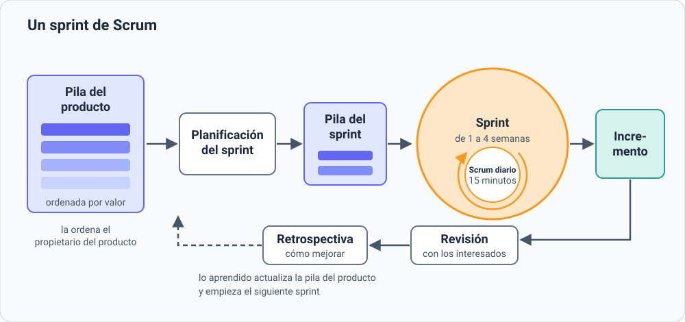
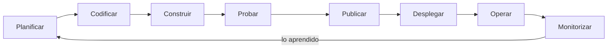

# 5. Metodologías ágiles

[⬅️ Volver a la unidad](./README.md)

## Índice

- [5.1. Por qué surgen las metodologías ágiles](#51-por-qué-surgen-las-metodologías-ágiles)
- [5.2. El Manifiesto ágil](#52-el-manifiesto-ágil)
  - [5.2.1. Los cuatro valores](#521-los-cuatro-valores)
  - [5.2.2. Los doce principios](#522-los-doce-principios)
- [5.3. Scrum](#53-scrum)
  - [5.3.1. Responsabilidades](#531-responsabilidades)
  - [5.3.2. Eventos](#532-eventos)
  - [5.3.3. Artefactos](#533-artefactos)
- [5.4. Kanban](#54-kanban)
- [5.5. Programación extrema (XP)](#55-programación-extrema-xp)
- [5.6. Otros métodos ágiles](#56-otros-métodos-ágiles)
- [5.7. Técnicas ágiles](#57-técnicas-ágiles)
  - [5.7.1. Historias de usuario](#571-historias-de-usuario)
  - [5.7.2. Criterios de aceptación](#572-criterios-de-aceptación)
  - [5.7.3. Estimar y priorizar](#573-estimar-y-priorizar)
- [5.8. Cuándo encaja una metodología ágil y cuándo no](#58-cuándo-encaja-una-metodología-ágil-y-cuándo-no)
- [5.9. Un tablero en GitHub Projects](#59-un-tablero-en-github-projects)
- [5.10. DevOps](#510-devops)
- [Resumen](#resumen)
- [Ejercicios de reflexión](#ejercicios-de-reflexión)

> **CE que trabaja este tema:** RA1 g.

---

## 5.1. Por qué surgen las metodologías ágiles

Imagina que encargas una casa y el constructor te pide que decidas **hoy**, para siempre, dónde irá cada enchufe. Dentro de dos años te la entrega. Cuando entras, descubres que el salón se te queda pequeño, pero ya no se puede cambiar.

Así funcionaban muchos proyectos de software en los años noventa: se seguía un modelo en cascada ([tema 4](./04-fases-del-desarrollo.md)) con mucha documentación, los requisitos se cerraban al principio y el cliente veía el producto meses o años después. Para entonces, el negocio había cambiado y el software ya no servía del todo.

Como reacción, varios desarrolladores propusieron métodos más **ligeros**: equipos pequeños, ciclos cortos, versiones que funcionan desde muy pronto y el cliente participando todo el tiempo. En 2001 se reunieron diecisiete de ellos y pusieron en común lo que tenían esos métodos: así nació el **Manifiesto ágil**.

---

## 5.2. El Manifiesto ágil

### 5.2.1. Los cuatro valores

El **Manifiesto por el Desarrollo Ágil de Software** (*Manifesto for Agile Software Development*) dice así en su versión oficial en español:

> Estamos descubriendo formas mejores de desarrollar software tanto por nuestra propia experiencia como ayudando a terceros. A través de este trabajo hemos aprendido a valorar:
>
> **Individuos e interacciones** sobre procesos y herramientas
>
> **Software funcionando** sobre documentación extensiva
>
> **Colaboración con el cliente** sobre negociación contractual
>
> **Respuesta ante el cambio** sobre seguir un plan
>
> Esto es, aunque valoramos los elementos de la derecha, valoramos más los de la izquierda.

Qué significa cada valor en la práctica:

| Valor | En la práctica |
|-------|----------------|
| Individuos e interacciones sobre procesos y herramientas | Un equipo que habla y se coordina bien rinde más que uno que sigue un proceso perfecto pero no se comunica |
| Software funcionando sobre documentación extensiva | La mejor medida del avance es una versión que el cliente puede usar, no un documento de doscientas páginas |
| Colaboración con el cliente sobre negociación contractual | El cliente forma parte del equipo y decide con él, en lugar de discutir cada cambio contra un contrato |
| Respuesta ante el cambio sobre seguir un plan | Si el negocio cambia, el plan se adapta, en lugar de seguir construyendo algo que ya no hace falta |

> ⚠️ **Cuidado**: Ágil **no** significa «sin documentación», «sin plan» ni «sin herramientas». La última frase del manifiesto lo deja claro: lo de la derecha **también** tiene valor, pero ante la duda, se prefiere lo de la izquierda. Un equipo ágil planifica (cada pocas semanas) y documenta (lo necesario).

### 5.2.2. Los doce principios

El manifiesto se completa con doce principios. Resumidos:

| # | Principio |
|---|-----------|
| 1 | La prioridad es **satisfacer al cliente** entregando pronto y de forma continua software que le aporta valor |
| 2 | Se **aceptan los cambios** de requisitos, incluso tarde, si dan ventaja al cliente |
| 3 | Se **entrega software que funciona** con frecuencia, de unas semanas a un par de meses, cuanto más a menudo mejor |
| 4 | El negocio y los desarrolladores **trabajan juntos** a diario |
| 5 | Los proyectos se construyen con **personas motivadas**, dándoles el entorno y la confianza que necesitan |
| 6 | La forma más eficaz de comunicarse es la **conversación cara a cara** |
| 7 | El **software que funciona** es la medida principal del progreso |
| 8 | Se trabaja a un **ritmo sostenible**, que se pueda mantener indefinidamente |
| 9 | La **excelencia técnica** y el buen diseño mejoran la agilidad |
| 10 | La **simplicidad**, maximizar el trabajo que **no** se hace, es esencial |
| 11 | Los mejores diseños surgen de **equipos que se organizan solos** |
| 12 | El equipo **reflexiona** con regularidad sobre cómo mejorar y ajusta su forma de trabajar |

> 💡 **Tip del Examinador**: En el examen se suele preguntar por los **cuatro valores** (sabértelos de memoria, con su «sobre») y por la idea de que el **software que funciona** es la medida del progreso.

---

## 5.3. Scrum

**Scrum** es el marco de trabajo (*framework*) ágil más usado. Lo crearon Ken Schwaber y Jeff Sutherland en los años noventa, y su definición oficial es **la Guía de Scrum**, un documento corto que revisan sus autores. Scrum organiza el trabajo en **sprints**: ciclos de duración fija, de **un mes como máximo** (lo habitual es entre una y cuatro semanas), al final de cada cual hay un **incremento** de producto que podría usarse.



La imagen muestra un sprint completo: se eligen elementos de la pila del producto, se trabaja en ellos con una reunión diaria y se termina con un incremento que se revisa con los interesados, seguido de la retrospectiva del equipo.

### 5.3.1. Responsabilidades

Un **equipo Scrum** (*Scrum Team*) es pequeño (normalmente diez personas o menos), **multidisciplinar** (tiene todas las habilidades para crear el producto) y **autogestionado** (decide él mismo quién hace qué y cómo). Hay tres responsabilidades:

| Responsabilidad | Qué hace |
|-----------------|----------|
| **Propietario del producto** (*Product Owner*) | Una persona que representa al cliente y a los usuarios. Decide **qué** se construye y en qué orden: gestiona la pila del producto y busca que el producto aporte el máximo valor |
| **Scrum Master** | Ayuda al equipo a aplicar Scrum y a mejorar: modera los eventos, elimina los obstáculos que frenan al equipo y lo protege de interrupciones. No es un jefe que manda |
| **Desarrolladores** (*Developers*) | Las personas que construyen el incremento: programan, diseñan, prueban, documentan. Deciden **cómo** hacer el trabajo |

### 5.3.2. Eventos

| Evento | Cuándo y cuánto dura | Para qué sirve |
|--------|----------------------|----------------|
| **Sprint** | Todo el ciclo, de una a cuatro semanas | Contiene a los demás eventos. Durante el sprint no se cambia su objetivo |
| **Planificación del sprint** (*Sprint Planning*) | Al principio; hasta 8 horas para un sprint de un mes | Decidir **por qué** es valioso el sprint (su objetivo), **qué** elementos de la pila se harán y **cómo** |
| **Scrum diario** (*Daily Scrum*) | Cada día, 15 minutos, a la misma hora | Los desarrolladores revisan el avance hacia el objetivo del sprint y ajustan el plan del día |
| **Revisión del sprint** (*Sprint Review*) | Al final; hasta 4 horas | Mostrar el incremento a los interesados y decidir juntos qué hacer después |
| **Retrospectiva del sprint** (*Sprint Retrospective*) | Al final, tras la revisión; hasta 3 horas | El equipo analiza **cómo** ha trabajado y acuerda mejoras para el siguiente sprint |

### 5.3.3. Artefactos

| Artefacto | Qué es | Su compromiso |
|-----------|--------|---------------|
| **Pila del producto** (*Product Backlog*) | La lista **ordenada** de todo lo que podría necesitar el producto (funciones, mejoras, correcciones). Nunca está terminada | El **objetivo del producto** (*Product Goal*): hacia dónde va |
| **Pila del sprint** (*Sprint Backlog*) | Los elementos elegidos para el sprint y el plan para hacerlos | El **objetivo del sprint** (*Sprint Goal*) |
| **Incremento** (*Increment*) | El producto con todo lo terminado hasta ahora, que funciona y se podría usar | La **definición de terminado** (*Definition of Done*): las condiciones que debe cumplir un elemento para darlo por terminado (por ejemplo, «probado, revisado y documentado») |

> 📝 **Nota del Profesor**: Fíjate en que Scrum **no dice nada** de cómo programar ni de cómo probar: es un marco para **organizar** el trabajo. Por eso se combina a menudo con las prácticas técnicas de XP (apartado 5.5).

---

## 5.4. Kanban

**Kanban** (en japonés, «tarjeta» o «señal») viene de la fábrica de Toyota, y en los años 2000 se adaptó al desarrollo de software. No tiene sprints ni responsabilidades fijas: se basa en **visualizar el trabajo** y **mejorar el flujo**.

Sus prácticas principales son:

1. **Visualizar el trabajo** en un **tablero** con una columna por cada estado y una **tarjeta** por cada tarea.
2. **Limitar el trabajo en curso** (*work in progress*, **WIP**): cada columna tiene un número máximo de tarjetas. Si una columna está llena, no se empieza nada nuevo: se ayuda a terminar lo que hay.
3. **Gestionar el flujo**: medir cuánto tarda una tarea en cruzar el tablero (**tiempo de ciclo**) y quitar los atascos.
4. **Hacer explícitas las normas**: por ejemplo, qué hace falta para pasar una tarjeta a «Hecho».
5. **Mejorar poco a poco**, sin grandes cambios de golpe.

Un tablero Kanban sencillo para la aplicación del taller del tema 4:

| Pendiente | En curso (máx. 2) | En revisión (máx. 2) | Hecho |
|-----------|-------------------|----------------------|-------|
| Recordatorio por correo | Anular una cita | Pedir cita | Página de inicio |
| Vista del personal | Cambiar una cita | | Alta de cliente |
| Exportar citas a la agenda | | | |

Las tarjetas avanzan de izquierda a derecha. La columna «En curso» ya tiene dos tarjetas, su límite: nadie empieza «Recordatorio por correo» hasta que una de ellas pase a revisión.

> 💡 **Tip del Examinador**: La diferencia clave con Scrum: **Scrum** trabaja en **sprints** de duración fija con un compromiso para cada uno; **Kanban** trabaja en **flujo continuo**, sin iteraciones, y controla la cantidad de trabajo con los **límites WIP**.

---

## 5.5. Programación extrema (XP)

La **programación extrema** (*Extreme Programming*, **XP**) la formuló Kent Beck a finales de los años noventa. Mientras Scrum organiza el trabajo, XP se centra en las **prácticas técnicas** que permiten cambiar el software con rapidez y sin romperlo. Su nombre viene de llevar al extremo las buenas prácticas: si revisar el código es bueno, se revisa todo el tiempo (programando en pareja); si probar es bueno, se prueba antes de programar.

Sus valores son la **comunicación**, la **simplicidad**, la **retroalimentación**, la **valentía** y el **respeto**. Sus prácticas más conocidas:

| Práctica | En qué consiste | En el curso |
|----------|-----------------|-------------|
| **Programación en pareja** (*pair programming*) | Dos personas en un mismo ordenador: una escribe y la otra revisa y piensa, y se turnan | — |
| **Desarrollo guiado por pruebas** (*test-driven development*, **TDD**) | Primero se escribe una prueba que falla, después el código mínimo para que pase, y después se mejora | UD4 |
| **Integración continua** | El código de todos se une al repositorio común varias veces al día, y cada vez se compila y se prueba automáticamente | UD5 |
| **Refactorización** | Mejorar la estructura del código sin cambiar lo que hace | UD5 |
| **Entregas pequeñas** | Versiones frecuentes, con pocas novedades cada una | — |
| **Diseño simple** | Hacer lo más sencillo que funcione, sin adelantarse a necesidades que quizá no lleguen | — |
| **Propiedad colectiva del código** | Cualquiera del equipo puede cambiar cualquier parte del código | UD3 |
| **Estándares de codificación** | Todo el equipo escribe el código con el mismo estilo | UD2 y UD5 |
| **Ritmo sostenible** | Nada de semanas de horas extra: el cansancio produce errores | — |
| **Cliente en el equipo** | Un representante del cliente está disponible para resolver dudas en el momento | — |

> 📝 **Nota del Profesor**: Muchas herramientas de este módulo nacieron o se popularizaron con XP: JUnit (UD4), la refactorización asistida por el IDE (UD5) y la integración continua (UD5). Cuando las uses, recuerda de dónde vienen.

---

## 5.6. Otros métodos ágiles

| Método | Idea central |
|--------|--------------|
| **Lean** (desarrollo de software esbelto) | Aplica al software las ideas de la fabricación de Toyota: **eliminar el desperdicio** (todo lo que no aporta valor al cliente: funciones que nadie usa, esperas, trabajo a medias), aprender rápido, decidir lo más tarde posible y entregar lo antes posible |
| **Crystal** | Una familia de métodos que se ajusta al **tamaño del equipo** y a lo **crítico** del proyecto: cuanto más grande y más crítico, más formalidad |
| **DSDM** (*Dynamic Systems Development Method*) | Plazo y coste fijos, y lo que varía son las funciones; prioriza con la técnica **MoSCoW** (*Must*, *Should*, *Could*, *Won't*: debe, debería, podría, no tendrá) |
| **FDD** (*Feature-Driven Development*) | Planifica y construye el producto **por funcionalidades** pequeñas, a partir de un modelo general del sistema |
| **Scrumban** | Mezcla de Scrum y Kanban: tablero con límites WIP dentro de una organización con algunos eventos de Scrum |

Para organizaciones con muchos equipos existen marcos de **escalado**, como SAFe o LeSS, que coordinan varios equipos Scrum trabajando en el mismo producto.

---

## 5.7. Técnicas ágiles

### 5.7.1. Historias de usuario

En lugar de una especificación de requisitos de cien páginas, los equipos ágiles describen lo que hay que construir con **historias de usuario** (*user stories*): frases cortas, escritas desde el punto de vista de quien va a usar la función.

La plantilla más usada es:

```text
Como <tipo de usuario>,
quiero <hacer algo>
para <conseguir un beneficio>.
```

Ejemplos para la aplicación del taller:

```text
Como cliente del taller,
quiero pedir cita desde el móvil
para no tener que llamar en horario de trabajo.
```

```text
Como mecánico,
quiero ver las citas del día ordenadas por hora
para organizar el trabajo de la mañana.
```

La historia no es un requisito completo: es un **recordatorio para conversar**. Los detalles se hablan con el propietario del producto y se fijan en los criterios de aceptación. Una buena historia cumple el criterio **INVEST**:

| Letra | Significa | La historia… |
|-------|-----------|--------------|
| I | Independiente | Se puede hacer sin esperar a otras |
| N | Negociable | Sus detalles se pueden hablar y cambiar |
| V | Valiosa | Aporta algo al usuario o al cliente |
| E | Estimable | El equipo puede calcular más o menos cuánto costará |
| S | Pequeña (*Small*) | Cabe en un sprint |
| T | Comprobable (*Testable*) | Se puede comprobar si está terminada |

### 5.7.2. Criterios de aceptación

Los **criterios de aceptación** (*acceptance criteria*) dicen exactamente qué tiene que pasar para dar la historia por buena. Se suelen escribir con el formato **Dado, Cuando, Entonces** (*Given, When, Then*), que describe un escenario:

```text
Historia: pedir cita desde el móvil

Escenario 1: hora libre
  Dado que el martes a las 10:00 no hay ninguna cita
  Cuando un cliente pide cita para el martes a las 10:00
  Entonces la cita queda reservada
  Y el cliente recibe un mensaje de confirmación

Escenario 2: hora ocupada
  Dado que el martes a las 10:00 ya hay una cita
  Cuando otro cliente intenta pedir cita para el martes a las 10:00
  Entonces la aplicación no reserva la cita
  Y le muestra las horas libres más cercanas
```

Cada escenario se puede convertir en una **prueba de aceptación** (UD4). Si todos los escenarios se cumplen y se cumple la definición de terminado, la historia está terminada.

> ✅ **Buena práctica**: Escribe siempre al menos un escenario del caso normal y uno de un caso que **falla** o que es límite (hora ocupada, fecha pasada, datos que faltan). Los errores suelen estar en los casos que nadie pensó.

### 5.7.3. Estimar y priorizar

- **Estimar**: el equipo calcula el **esfuerzo** relativo de cada historia, a menudo en **puntos de historia** (*story points*), comparándolas entre sí («esta cuesta el doble que aquella») en lugar de en horas. Una técnica habitual es el **póquer de planificación** (*planning poker*): cada miembro elige en secreto una carta con su estimación, se enseñan a la vez y, si hay mucha diferencia, se discute y se repite.
- **Velocidad**: los puntos que el equipo termina por sprint. Sirve para prever cuánto cabe en los siguientes.
- **Priorizar**: el propietario del producto ordena la pila por **valor** para el cliente, por riesgo y por dependencias. Lo más valioso, arriba.

---

## 5.8. Cuándo encaja una metodología ágil y cuándo no

Ninguna metodología sirve para todo. Lo ágil encaja mejor en unos escenarios que en otros:

| Encaja bien cuando… | Encaja peor cuando… |
|---------------------|---------------------|
| Los requisitos no están claros o van a cambiar | Los requisitos están cerrados por una norma o un contrato que no se puede tocar |
| El cliente puede participar a menudo | El cliente no tiene tiempo para el proyecto y solo quiere el resultado final |
| El equipo es pequeño, está en contacto y tiene todas las habilidades | Hay muchos equipos muy repartidos y sin coordinación (necesita un marco de escalado) |
| Se puede entregar algo útil en pocas semanas | El producto solo tiene sentido completo (por ejemplo, el software de un satélite que se lanza una vez) |
| Interesa salir pronto al mercado y aprender de los usuarios | La normativa exige documentar y aprobar formalmente cada fase (sanidad, aviación), aunque también ahí se combinan prácticas ágiles con un proceso más formal |

En la práctica, muchas organizaciones usan modelos **híbridos**: planifican el proyecto a grandes rasgos y lo desarrollan en sprints, o usan Kanban para el mantenimiento y Scrum para las funciones nuevas.

> 💡 **Tip del Examinador**: Si te dan un caso y te piden si aplicarías una metodología ágil, justifica con estos criterios: **¿cambian los requisitos? ¿está disponible el cliente? ¿se puede entregar por partes? ¿qué tamaño tiene el equipo? ¿hay normas que exigen un proceso formal?**

---

## 5.9. Un tablero en GitHub Projects

**GitHub Projects** es la herramienta de planificación integrada en GitHub. Permite crear un tablero al estilo Kanban o Scrum con **elementos** (*items*) que pueden ser notas sueltas o incidencias de tus repositorios. Lo usarás en el ejercicio E05.

GitHub está en inglés: aquí tienes los nombres tal como aparecen y su traducción. Pueden cambiar en futuras versiones, pero la idea será la misma.

1. En tu perfil de GitHub (o en un repositorio), abre la pestaña **Projects** (proyectos) y pulsa **New project** (nuevo proyecto).
2. Elige la plantilla **Board** (tablero) y ponle un nombre. Se crea con tres columnas, que corresponden a los valores del campo **Status** (estado): **Todo** (pendiente), **In Progress** (en curso) y **Done** (hecho).
3. Pulsa **+ Add item** (añadir elemento) al pie de una columna y escribe el título. Se crea un borrador (*draft*); al abrirlo puedes escribir la descripción, por ejemplo la historia de usuario completa y sus criterios de aceptación.
4. Arrastra las tarjetas entre columnas a medida que avanza el trabajo.
5. Desde el menú de cada columna puedes fijar un **límite** de elementos (el límite WIP de Kanban).
6. Puedes añadir **campos** propios desde el menú de la vista: un campo numérico para la estimación en puntos o un campo de tipo **Iteration** (iteración) para organizar los elementos por sprints.
7. En la configuración del proyecto (**Settings**) eliges si es **público** o **privado**. Para que otra persona lo vea por un enlace, tiene que ser público o tiene que tener acceso.

> 📝 **Nota del Profesor**: Las mismas ideas funcionan en otras herramientas, como Jira, Trello, Taiga o GitLab. Lo importante no es la herramienta, sino el tablero: columnas por estado, una tarjeta por elemento y el trabajo visible para todo el equipo.

---

## 5.10. DevOps

En una organización tradicional, el equipo de **desarrollo** (*development*, **Dev**) escribe el software y lo «pasa» al equipo de **operaciones** (*operations*, **Ops**), que lo instala y lo mantiene funcionando en los servidores. Los primeros quieren cambiar rápido; los segundos, que nada se rompa. El resultado son entregas lentas y culpas cruzadas.

**DevOps** es una **cultura** y un **conjunto de prácticas** que une a los dos equipos: comparten la responsabilidad del software desde que se escribe hasta que funciona en producción, y **automatizan** todo lo posible para entregar a menudo y con seguridad. No es una metodología ni un modelo de ciclo de vida, sino una forma de trabajar que extiende las ideas ágiles hasta la explotación.



El diagrama muestra el ciclo DevOps, que se suele dibujar como un ocho infinito: la información que se obtiene al monitorizar la aplicación en producción vuelve a la planificación.

Sus prácticas principales:

| Práctica | En qué consiste |
|----------|-----------------|
| **Integración continua** (*continuous integration*, **CI**) | Cada cambio se integra en el repositorio común y se compila y se prueba automáticamente (UD5) |
| **Entrega continua** (*continuous delivery*, **CD**) | Cada cambio que pasa las pruebas queda listo para publicarse con un solo paso |
| **Despliegue continuo** (*continuous deployment*) | Cada cambio que pasa las pruebas se publica en producción automáticamente |
| **Infraestructura como código** | Los servidores y su configuración se describen en ficheros que se guardan en el control de versiones |
| **Monitorización** | Se vigila la aplicación en producción (errores, rendimiento, uso) para reaccionar rápido y aprender |

> 📝 **Nota del Profesor**: Muchas de las herramientas de DevOps son las de este módulo: el control de versiones (UD3), las pruebas automáticas (UD4), la integración continua (UD5) y los contenedores ([tema 3](./03-del-codigo-al-ejecutable.md)). Ten en cuenta que hay muchos «modelos de equipo» DevOps (centralizado, como plataforma, con ingenieros de fiabilidad o SRE…), pero todos comparten las ideas de esta tabla.

---

## Resumen

- Las **metodologías ágiles** surgen frente a los procesos pesados: ciclos cortos, software que funciona pronto y el cliente participando.
- El **Manifiesto ágil** (2001) tiene **cuatro valores** (individuos e interacciones, software funcionando, colaboración con el cliente, respuesta ante el cambio) y **doce principios**. Ágil no significa sin plan ni sin documentación.
- **Scrum**: sprints de un mes como máximo; responsabilidades (propietario del producto, Scrum Master, desarrolladores); eventos (planificación, scrum diario, revisión, retrospectiva); artefactos (pila del producto, pila del sprint, incremento) con sus compromisos.
- **Kanban**: tablero, flujo continuo y **límites de trabajo en curso**. **XP**: prácticas técnicas como la programación en pareja, TDD, la integración continua y la refactorización.
- Técnicas: **historias de usuario** («Como…, quiero…, para…», criterio INVEST), **criterios de aceptación** (Dado, Cuando, Entonces), **estimación** en puntos y priorización por valor.
- Lo ágil encaja cuando los requisitos cambian, el cliente participa y se puede entregar por partes; encaja peor con requisitos cerrados por norma o contrato.
- **DevOps** es una cultura y un conjunto de prácticas (CI, CD, infraestructura como código, monitorización) que une desarrollo y operaciones.

## Ejercicios de reflexión

1. Elige uno de los cuatro valores del Manifiesto ágil y pon un ejemplo de un proyecto (real o inventado) en el que haberlo seguido habría evitado un problema.
2. ¿Qué ventajas e inconvenientes tendría organizar un trabajo de clase de varias semanas en sprints de una semana, con una revisión con el profesor al final de cada uno?
3. Escribe una historia de usuario para una aplicación que uses a diario, con dos escenarios de aceptación: uno normal y uno en el que algo falla.
4. ¿Por qué crees que un tablero Kanban limita el trabajo en curso? ¿Qué pasaría en tu tablero personal de tareas si no lo hicieras?

---

[⬅️ Volver a la unidad](./README.md)
