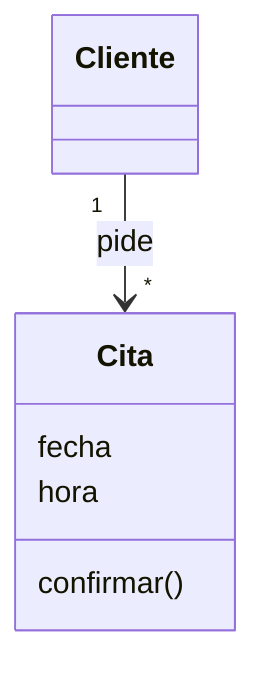
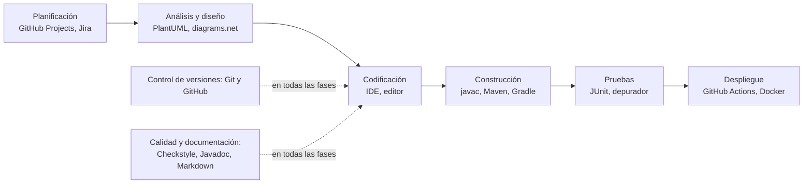

# 6. Herramientas del desarrollo de software

[⬅️ Volver a la unidad](./README.md)

## Índice

- [6.1. Para qué sirven las herramientas](#61-para-qué-sirven-las-herramientas)
- [6.2. Panorama: una herramienta para cada fase](#62-panorama-una-herramienta-para-cada-fase)
  - [6.2.1. Planificación y gestión del proyecto](#621-planificación-y-gestión-del-proyecto)
  - [6.2.2. Análisis y diseño: modelado y herramientas CASE](#622-análisis-y-diseño-modelado-y-herramientas-case)
  - [6.2.3. Edición: editores y entornos integrados](#623-edición-editores-y-entornos-integrados)
  - [6.2.4. Traducción y construcción](#624-traducción-y-construcción)
  - [6.2.5. Control de versiones](#625-control-de-versiones)
  - [6.2.6. Depuración y pruebas](#626-depuración-y-pruebas)
  - [6.2.7. Calidad y documentación](#627-calidad-y-documentación)
  - [6.2.8. Integración continua y despliegue](#628-integración-continua-y-despliegue)
  - [6.2.9. Resumen del panorama](#629-resumen-del-panorama)
- [6.3. Integradas o por separado: el IDE y la terminal](#63-integradas-o-por-separado-el-ide-y-la-terminal)
- [6.4. Asistentes de código con inteligencia artificial](#64-asistentes-de-código-con-inteligencia-artificial)
- [6.5. Cómo evaluar una herramienta](#65-cómo-evaluar-una-herramienta)
  - [6.5.1. Criterios](#651-criterios)
  - [6.5.2. Dónde encontrar los datos](#652-dónde-encontrar-los-datos)
  - [6.5.3. La matriz de decisión ponderada](#653-la-matriz-de-decisión-ponderada)
- [6.6. Ejemplo integrador: la caja de herramientas del curso](#66-ejemplo-integrador-la-caja-de-herramientas-del-curso)
- [Resumen](#resumen)
- [Ejercicios de reflexión](#ejercicios-de-reflexión)

> **CE que trabaja este tema:** RA1 f.

---

## 6.1. Para qué sirven las herramientas

Un carpintero podría hacer una mesa solo con un serrucho y un martillo, pero con una sierra de calar, una lijadora y un taladro la hace antes, mejor y con menos esfuerzo. En el desarrollo de software pasa lo mismo: las **herramientas de desarrollo** son programas que ayudan a crear otros programas.

Sirven para:

- **Ser más productivo**: escribir menos, encontrar antes lo que buscas y automatizar las tareas repetitivas (compilar, probar, empaquetar).
- **Mejorar la calidad**: detectar errores pronto, mantener un estilo uniforme y medir lo que se ha probado.
- **Trabajar en equipo**: compartir el código sin pisarse, revisar el trabajo de otros y saber qué hace cada uno.
- **Hacer el trabajo repetible**: que construir, probar y desplegar la aplicación salga igual en cualquier equipo y en cualquier momento.

Este tema es un **mapa**: verás qué tipo de herramienta se usa en cada fase del desarrollo ([tema 4](./04-fases-del-desarrollo.md)) y cómo se evalúa una herramienta. Las más importantes las aprenderás a usar en el resto de unidades del módulo.

---

## 6.2. Panorama: una herramienta para cada fase

### 6.2.1. Planificación y gestión del proyecto

Sirven para organizar el trabajo: qué hay que hacer, quién lo hace, en qué estado está y cuándo estará.

- **Gestores de tareas y tableros**: GitHub Projects, Jira, Trello, Taiga, GitLab Issues. Permiten tableros Kanban o Scrum, historias de usuario, sprints y estimaciones ([tema 5](./05-metodologias-agiles.md)).
- **Gestores de incidencias** (*issue trackers*): registran errores y peticiones, con su estado, prioridad y responsable. GitHub Issues, Jira, Bugzilla (UD4).
- **Comunicación del equipo**: chats como Slack, Microsoft Teams, Discord o Mattermost, y wikis como Confluence o la wiki de GitHub.

### 6.2.2. Análisis y diseño: modelado y herramientas CASE

Las **herramientas CASE** (*Computer-Aided Software Engineering*, ingeniería del software asistida por ordenador) son las que ayudan en las fases del desarrollo, y en especial en el análisis y el diseño. Las más usadas hoy son las de **modelado**, que dibujan diagramas (normalmente en **UML**, el lenguaje unificado de modelado) y algunas generan código a partir de ellos o al revés.

| Tipo | Cómo se hace el diagrama | Ejemplos |
|------|--------------------------|----------|
| Diagramas como texto | Se escribe el diagrama en un lenguaje sencillo y la herramienta lo dibuja. Se guarda en el repositorio como cualquier fichero de código | PlantUML, Mermaid |
| Herramientas gráficas | Se dibuja arrastrando elementos con el ratón | diagrams.net, StarUML, Visual Paradigm, Modelio |

Por ejemplo, este diagrama de Mermaid (lo verás a fondo en la UD6) se escribe así:

```text
classDiagram
    class Cita {
        fecha
        hora
        confirmar()
    }
    Cliente "1" --> "*" Cita : pide
```

Y se ve así:



El diagrama muestra dos clases de la aplicación del taller del tema 4: un cliente puede pedir muchas citas.

> 📝 **Nota del Profesor**: Las herramientas CASE se suelen clasificar en **CASE superior** (*upper CASE*), para las primeras fases (requisitos, análisis y diseño), y **CASE inferior** (*lower CASE*), para las últimas (codificación, pruebas, documentación). Muchas herramientas actuales, como el IDE, hacen funciones de los dos tipos. Las verás con más detalle en la UD2 y las usarás para modelar en la UD6 y la UD7.

### 6.2.3. Edición: editores y entornos integrados

Donde se escribe el código.

- **Editores de texto** para programar: resaltan la sintaxis y, con extensiones, hacen mucho más. Visual Studio Code, Vim, Neovim, Notepad++, Sublime Text.
- **Entornos de desarrollo integrados** (*integrated development environment*, **IDE**): reúnen en un solo programa el editor, el compilador, el depurador, el control de versiones, la terminal y muchas más herramientas. IntelliJ IDEA, Eclipse, NetBeans, Android Studio (basado en IntelliJ IDEA), Visual Studio.

Los instalarás, configurarás y compararás en la **UD2**.

### 6.2.4. Traducción y construcción

- **Traductores**: compiladores, intérpretes y máquinas virtuales ([tema 3](./03-del-codigo-al-ejecutable.md)). `javac` y la JVM, `gcc`, `python`.
- **Herramientas de construcción** (*build tools*): automatizan todo el proceso de obtener el ejecutable: descargar las **dependencias** (las bibliotecas que usa el proyecto), compilar, ejecutar las pruebas y empaquetar. Para Java, **Maven** y **Gradle**; en otros lenguajes, Make, npm, pip o Cargo.

En lugar de escribir a mano las órdenes del [tema 3](./03-del-codigo-al-ejecutable.md), con Maven basta con una orden como `./mvnw package`. Lo verás en la **UD2**.

### 6.2.5. Control de versiones

Guardan la **historia** de todos los cambios del código: quién cambió qué, cuándo y por qué. Permiten volver atrás, trabajar en paralelo en **ramas** y unir el trabajo de varias personas.

- **Sistemas de control de versiones**: **Git** (el más usado), Mercurial, Subversion.
- **Plataformas** que alojan los repositorios y añaden colaboración (revisiones, incidencias, integración continua): **GitHub**, GitLab, Bitbucket, Gitea.

Lo aprenderás en la **UD3**.

### 6.2.6. Depuración y pruebas

- **Depuradores**: ejecutan el programa paso a paso, con puntos de ruptura, para ver qué pasa por dentro ([tema 3](./03-del-codigo-al-ejecutable.md)). Todos los IDE traen uno.
- **Marcos de pruebas** (*testing frameworks*): para escribir y ejecutar pruebas automáticas. En Java, **JUnit**; para crear dobles de prueba, **Mockito**.
- **Cobertura**: miden qué parte del código ejecutan las pruebas. **JaCoCo**, o la del propio IDE.
- **Pruebas de interfaz y de rendimiento**: Selenium o Playwright (aplicaciones web), JMeter (rendimiento).

Lo aprenderás en la **UD4**.

### 6.2.7. Calidad y documentación

- **Analizadores de código** (*static analysis*): revisan el código **sin ejecutarlo** y avisan de errores probables, malas prácticas, código duplicado o problemas de estilo. **Checkstyle**, **PMD**, **SpotBugs**, SonarQube, y las inspecciones del IDE.
- **Formateadores**: dejan el código con un estilo uniforme. El formateador del IDE, y ficheros como `.editorconfig` que comparten las reglas.
- **Generadores de documentación**: crean la documentación a partir de comentarios especiales del código. **Javadoc** en Java.
- **Lenguajes de documentación**: **Markdown**, para los README y los documentos del proyecto (como estos apuntes).

Lo aprenderás en la **UD5**.

### 6.2.8. Integración continua y despliegue

- **Servidores de integración continua**: cada vez que se suben cambios al repositorio, compilan, prueban y analizan el proyecto de forma automática, y avisan si algo se rompe. **GitHub Actions**, GitLab CI/CD, Jenkins (UD5).
- **Contenedores y virtualización**: Docker, Podman, VirtualBox ([tema 3](./03-del-codigo-al-ejecutable.md)).
- **Plataformas de despliegue y en la nube**, donde se ejecutan las aplicaciones en producción.

### 6.2.9. Resumen del panorama



El diagrama sitúa cada tipo de herramienta en su fase; el control de versiones, la calidad y la documentación acompañan a todo el proceso.

| Fase o actividad | Tipo de herramienta | Ejemplos | Unidad |
|------------------|---------------------|----------|--------|
| Planificación | Tableros, gestores de tareas e incidencias | GitHub Projects, Jira, Trello, GitHub Issues | UD1, UD4 |
| Análisis y diseño | Modelado UML, herramientas CASE | PlantUML, Mermaid, diagrams.net, StarUML | UD6, UD7 |
| Codificación | Editores e IDE | IntelliJ IDEA, VS Code, Eclipse, NetBeans | UD2 |
| Construcción | Traductores y herramientas de construcción | `javac`, Maven, Gradle | UD1, UD2 |
| Control de versiones | Sistemas y plataformas | Git, GitHub, GitLab | UD3 |
| Pruebas | Depuradores, marcos de pruebas, cobertura | Depurador del IDE, JUnit, Mockito, JaCoCo | UD4 |
| Calidad | Analizadores y formateadores | Checkstyle, PMD, SpotBugs, SonarQube | UD5 |
| Documentación | Generadores y lenguajes de documentación | Javadoc, Markdown | UD5 |
| Integración y despliegue | Integración continua, contenedores | GitHub Actions, Jenkins, Docker | UD1, UD5 |

> 💡 **Tip del Examinador**: Si te piden la **función** de una herramienta, responde **qué problema resuelve y en qué fase**, no solo su nombre: «Maven es una herramienta de **construcción**: automatiza la descarga de dependencias, la compilación, las pruebas y el empaquetado de un proyecto Java».

---

## 6.3. Integradas o por separado: el IDE y la terminal

Un IDE reúne muchas de estas herramientas en una sola ventana: al pulsar **Ejecutar**, compila con el compilador, ejecuta con la JVM y muestra la salida; al pulsar **Depurar**, lanza el depurador. Pero por debajo siguen siendo **herramientas separadas** que también se pueden usar desde la **terminal**.

| | Desde el IDE | Desde la terminal |
|---|--------------|-------------------|
| Ventajas | Visual, rápido de aprender, todo a mano | Se puede automatizar y repetir igual en cualquier equipo |
| Inconvenientes | Cada IDE lo hace a su manera; esconde lo que pasa | Hay que conocer las órdenes |
| Quién lo usa | El programador, mientras desarrolla | Los guiones de construcción y los servidores de integración continua, que no tienen IDE |

> ✅ **Buena práctica**: Aprende a hacer las tareas importantes (compilar, probar, empaquetar, subir los cambios) **de las dos formas**. El IDE te hace más rápido, pero la integración continua solo entiende la terminal, y si el IDE falla, sabrás qué hay por debajo.

---

## 6.4. Asistentes de código con inteligencia artificial

Los **asistentes de código con IA** son herramientas basadas en modelos de lenguaje que generan código y texto a partir de lo que escribes o de lo que les pides. Se usan dentro del IDE (como complemento) o en un chat. Ejemplos: GitHub Copilot, JetBrains AI Assistant, Gemini Code Assist, o asistentes generales como Claude o ChatGPT.

**Qué pueden hacer**: completar líneas o funciones enteras mientras escribes, generar código a partir de una descripción, explicar código que no entiendes, proponer pruebas, buscar la causa de un error o proponer cambios para mejorar el código.

**Con qué cautelas usarlos**:

- **Se equivocan**, y con mucha seguridad: generan código que parece correcto pero no compila, usa funciones que no existen o hace algo distinto de lo pedido. **Todo lo que generen hay que revisarlo y probarlo.**
- **Seguridad**: pueden proponer código con vulnerabilidades o prácticas inseguras.
- **Privacidad y datos**: lo que les envías puede salir de tu equipo. No se les debe dar código o datos confidenciales sin permiso de la empresa o del centro.
- **Licencias**: el código generado puede parecerse a código con licencia de otros.
- **Aprendizaje**: si dejas que el asistente haga el trabajo, no aprendes. En formación, úsalo para **entender**, no para entregar lo que no sabrías explicar.

> ⚠️ **Cuidado**: Eres **responsable** de todo el código que entregas, lo hayas escrito tú o un asistente. Si no sabes explicar una línea, no la entregues. Sigue siempre las normas del módulo sobre el uso de la IA en cada ejercicio.

---

## 6.5. Cómo evaluar una herramienta

### 6.5.1. Criterios

Para elegir entre varias herramientas de la misma categoría, no basta con «la que usa todo el mundo». Estos son los criterios habituales:

| Criterio | Qué preguntarse |
|----------|-----------------|
| **Funciones** | ¿Hace lo que necesito? ¿Le falta algo importante? |
| **Licencia y coste** | ¿Es libre o propietaria? ¿Gratuita, de pago o gratuita con límites? ¿Puedo usarla en mi empresa o en clase? (Las licencias las verás en la UD2) |
| **Plataformas** | ¿Funciona en los sistemas operativos del equipo (Windows, GNU/Linux, macOS)? ¿Es de escritorio, web o de terminal? |
| **Integración** | ¿Se integra con las demás herramientas: el IDE, el control de versiones, la integración continua? |
| **Comunidad y documentación** | ¿Tiene buena documentación? ¿Hay tutoriales, respuestas a dudas, extensiones? |
| **Mantenimiento** | ¿Sigue activa? ¿Cuándo salió la última versión? ¿Quién la respalda (una empresa, una fundación, una sola persona)? |
| **Curva de aprendizaje** | ¿Cuánto cuesta empezar a usarla? |
| **Rendimiento** | ¿Funciona con fluidez en los equipos que tenemos? |
| **Seguridad y privacidad** | ¿Dónde guarda los datos? ¿Envía algo a servidores externos? |

No todos los criterios pesan igual: depende del **contexto**. Para un equipo de clase con ordenadores modestos, el coste y el rendimiento pesan mucho; para una gran empresa, quizá pesen más la integración y el soporte.

### 6.5.2. Dónde encontrar los datos

Para que la evaluación sea objetiva, cada dato tiene que salir de una **fuente** y llevar la **fecha** en que lo consultaste, porque cambian:

- La **web oficial** y la **documentación**: funciones, plataformas, precios y licencia.
- El **repositorio** de la herramienta, si es de código abierto: fecha de la última versión (*releases*), frecuencia de los cambios (*commits*), incidencias abiertas, número de personas que contribuyen.
- El **fichero de licencia** del repositorio (`LICENSE`).
- Encuestas y comparativas de fuentes reconocidas, con cuidado de que sean recientes.

### 6.5.3. La matriz de decisión ponderada

Una **matriz de decisión ponderada** convierte la comparación en números:

1. Elige los **criterios** que importan en tu contexto.
2. Da a cada criterio un **peso** según su importancia (por ejemplo, de 1 a 3) y **justifícalo**.
3. Puntúa cada herramienta en cada criterio (por ejemplo, de 1 a 5), con los datos que has recogido.
4. Multiplica peso por puntuación y **suma**: gana la herramienta con el total más alto.

**Ejemplo.** Un equipo de clase tiene que elegir una herramienta para dibujar los diagramas UML de su proyecto. Los diagramas se guardarán en el repositorio junto al código, y el equipo quiere ver en cada cambio qué se ha modificado. Compara **PlantUML** (diagramas como texto) y **diagrams.net** (herramienta gráfica):

| Criterio | Peso | Por qué ese peso | PlantUML | diagrams.net |
|----------|-----:|------------------|---------:|-------------:|
| Los diagramas se guardan y comparan bien en el repositorio | 3 | El equipo revisa cada cambio en el repositorio | 5 | 3 |
| Notación UML completa | 3 | Los diagramas se evalúan en las unidades de UML | 5 | 3 |
| Facilidad para empezar | 2 | Hay poco tiempo de clase | 3 | 5 |
| Licencia y coste | 2 | El centro no paga licencias | 5 | 5 |
| Integración con el IDE | 2 | Se trabaja todo el día en el IDE | 5 | 4 |
| Plataformas | 1 | Todos usan el mismo sistema en el aula | 5 | 5 |
| **Total** | | | **61** | **51** |

Cómo se calcula el total de PlantUML: 3 × 5 + 3 × 5 + 2 × 3 + 2 × 5 + 2 × 5 + 1 × 5 = 15 + 15 + 6 + 10 + 10 + 5 = **61**. El de diagrams.net: 9 + 9 + 10 + 10 + 8 + 5 = **51**. El máximo posible sería 13 × 5 = 65.

**Conclusión**: en este contexto, PlantUML. Pero si el contexto fuera otro, por ejemplo, un diagrama para una presentación a un cliente, sin repositorio y con poco tiempo, los pesos cambiarían y probablemente ganaría diagrams.net.

> ⚠️ **Cuidado**: La matriz no decide sola: decide con los **pesos** que tú pones. Si cambias los pesos para que gane la herramienta que ya te gustaba, la matriz no sirve de nada. Por eso cada peso se **justifica con el contexto** antes de puntuar.

> 💡 **Tip del Examinador**: Comprueba siempre que la **conclusión coincide con la matriz**: si eliges la herramienta que no tiene el total más alto, tienes que explicar por qué, o revisar los pesos.

---

## 6.6. Ejemplo integrador: la caja de herramientas del curso

Estas son las herramientas que usarás en este módulo, ordenadas por fase. Fíjate en que cubren todo el ciclo de vida del tema 4, y en que muchas aparecen en las prácticas de XP y DevOps del tema 5.

| Fase | Herramienta del curso | Qué hace | Unidad |
|------|-----------------------|----------|--------|
| Planificación | GitHub Projects | Tablero con las tareas y su estado | UD1 |
| Codificación | El IDE que uses en Programación (IntelliJ IDEA, Eclipse, NetBeans, VS Code…) y, en la UD2, otro para compararlo | Escribir, ejecutar y depurar el código | UD2 |
| Traducción | El JDK que uses en Programación, versión 17 o posterior (`javac`, `java`, `jar`) | Compilar, ejecutar y empaquetar | UD1 |
| Construcción | Maven con Maven Wrapper (`./mvnw`) | Automatizar dependencias, compilación, pruebas y empaquetado | UD2 |
| Control de versiones | Git y GitHub | Historia del código, ramas, colaboración y entregas | UD3 |
| Pruebas | Depurador del IDE, JUnit, Mockito, JaCoCo | Depurar, probar automáticamente y medir la cobertura | UD4 |
| Incidencias | GitHub Issues | Registrar y seguir los errores | UD4 |
| Calidad | Checkstyle, PMD y las inspecciones del IDE | Revisar el estilo y los errores probables | UD5 |
| Documentación | Javadoc y Markdown | Documentar el código y el proyecto | UD5 |
| Integración continua | GitHub Actions | Compilar y probar en cada cambio | UD5 |
| Diseño | PlantUML y Mermaid | Diagramas UML como texto | UD6, UD7 |

En los ejercicios, cada herramienta que aprendas **se seguirá usando** en las unidades siguientes: al final del curso tendrás un flujo de trabajo completo, como el de un equipo profesional.

> 📝 **Nota del Profesor**: No es la única caja de herramientas posible: otro equipo podría usar Eclipse, Gradle, GitLab y Jenkins y trabajar igual de bien. Lo importante es que **sepas qué función cumple cada herramienta**, para poder cambiar una por otra cuando lo pida tu empresa.

---

## Resumen

- Las **herramientas de desarrollo** aumentan la productividad y la calidad, facilitan el trabajo en equipo y hacen el proceso repetible.
- Hay herramientas para cada fase: **planificación** (tableros, incidencias), **análisis y diseño** (modelado UML, **herramientas CASE**), **codificación** (editores e **IDE**), **construcción** (traductores, **Maven**, Gradle), **control de versiones** (Git, GitHub), **pruebas** (depuradores, JUnit, cobertura), **calidad y documentación** (analizadores, Javadoc, Markdown) e **integración continua y despliegue** (GitHub Actions, Docker).
- El **IDE** integra muchas herramientas, pero por debajo son programas separados que también se usan desde la **terminal**, que es lo que usa la integración continua.
- Los **asistentes de código con IA** ayudan, pero se equivocan: todo lo que generan se revisa y se prueba, y eres responsable de lo que entregas.
- Para **evaluar** una herramienta se usan criterios (funciones, licencia y coste, plataformas, integración, comunidad, mantenimiento, curva de aprendizaje, rendimiento, seguridad), datos con **fuente y fecha**, y una **matriz de decisión ponderada** con pesos justificados por el contexto.

## Ejercicios de reflexión

1. Elige una herramienta que ya uses (un editor, una aplicación de notas, un gestor de tareas…) y evalúala con cinco de los criterios del apartado 6.5.1.
2. En la matriz del apartado 6.5.3, ¿qué pesos tendrías que cambiar para que ganara diagrams.net? ¿En qué contexto tendría sentido ese cambio?
3. ¿Qué tareas del desarrollo dejarías hacer a un asistente de IA y cuáles no? Justifícalo.
4. Busca el repositorio de una herramienta de la tabla del apartado 6.6 en GitHub. ¿Cuándo salió su última versión? ¿Qué licencia tiene? ¿Cuántas personas han contribuido?

---

[⬅️ Volver a la unidad](./README.md)
