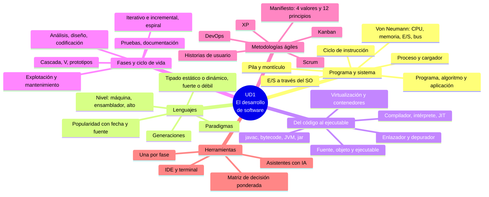

# 7. Resumen y mapa mental

[⬅️ Volver a la unidad](./README.md)

## Índice

- [Resumen ejecutivo](#resumen-ejecutivo)
- [Mapa mental](#mapa-mental)
- [Checklist de evaluación](#checklist-de-evaluación)
  - [El programa y el sistema informático (CE a)](#el-programa-y-el-sistema-informático-ce-a)
  - [Lenguajes de programación (CE e)](#lenguajes-de-programación-ce-e)
  - [Del código fuente al ejecutable (CE c, d)](#del-código-fuente-al-ejecutable-ce-c-d)
  - [Fases del desarrollo y ciclo de vida (CE b)](#fases-del-desarrollo-y-ciclo-de-vida-ce-b)
  - [Metodologías ágiles (CE g)](#metodologías-ágiles-ce-g)
  - [Herramientas del desarrollo (CE f)](#herramientas-del-desarrollo-ce-f)

## Resumen ejecutivo

En esta unidad has visto **qué elementos y herramientas intervienen en el desarrollo de un programa** y **por qué fases pasa** hasta que se usa:

1. **El programa y el sistema informático**: programa, algoritmo y aplicación; tipos de software y de aplicaciones (multiplataforma es una característica, no un tipo); la arquitectura de Von Neumann; qué pasa al ejecutar un programa: proceso, cargador, ciclo de instrucción, zonas de memoria (código, datos, montículo y pila), periféricos a través del sistema operativo y estados de un proceso.
2. **Lenguajes de programación**: léxico, sintaxis y semántica; clasificación por nivel, generaciones, forma de traducirse, paradigma (imperativo, orientado a objetos, funcional, declarativo, lógico y orientado a eventos), tipado (estático o dinámico, fuerte o débil) y propósito; los lenguajes más difundidos y cómo consultar su popularidad.
3. **Del código fuente al ejecutable**: código fuente, objeto y ejecutable; compilador y sus fases, intérprete, JIT y transpilador; preprocesador, enlazador, cargador y depurador; el caso de Java (`javac`, *bytecode*, `javap`, JVM, `jar`, JDK); máquinas virtuales de proceso y de sistema, y contenedores; errores de compilación, de ejecución y de lógica.
4. **Fases del desarrollo y ciclo de vida**: la ingeniería del software; análisis, diseño, codificación, pruebas, documentación, explotación y mantenimiento, con lo que sale de cada una; modelos en cascada, en V, de prototipos, iterativo e incremental y en espiral, y cómo elegir.
5. **Metodologías ágiles**: el Manifiesto (valores y principios); Scrum, Kanban y XP; historias de usuario, criterios de aceptación y estimación; cuándo encaja lo ágil; GitHub Projects; DevOps.
6. **Herramientas del desarrollo**: el panorama por fase, el IDE frente a la terminal, los asistentes con IA y cómo evaluar una herramienta con criterios y una matriz ponderada.

## Mapa mental

## Checklist de evaluación

Marca cada casilla cuando puedas hacerlo sin mirar los apuntes.

### El programa y el sistema informático (CE a)

- [ ] Sé explicar la diferencia entre algoritmo, programa, aplicación y proceso.
- [ ] Sé clasificar un programa como software de sistema, de desarrollo o de aplicación, y una aplicación como de escritorio, web o móvil.
- [ ] Entiendo que «multiplataforma» significa que un mismo código funciona en varias plataformas, no que la aplicación sea móvil.
- [ ] Sé nombrar los componentes de la arquitectura de Von Neumann y la función de cada uno.
- [ ] Sé explicar qué hacen el sistema operativo y el cargador al ejecutar un programa, y el ciclo de instrucción del procesador.
- [ ] Sé decir en qué zona de memoria (código, datos, montículo o pila) está cada elemento de un programa Java sencillo.
- [ ] Entiendo por qué un programa usa los periféricos a través del sistema operativo y qué es un proceso bloqueado.

### Lenguajes de programación (CE e)

- [ ] Sé distinguir lenguaje máquina, ensamblador y lenguajes de alto nivel, y sus ventajas e inconvenientes.
- [ ] Sé situar un lenguaje en su generación y sé que la generación no depende de la fecha.
- [ ] Sé reconocer el paradigma de un fragmento de código: imperativo, orientado a objetos, funcional, declarativo, lógico u orientado a eventos.
- [ ] Sé explicar la diferencia entre tipado estático y dinámico, y entre fuerte y débil, con un ejemplo de cada uno.
- [ ] Sé describir las características y los usos de los lenguajes más difundidos y consultar su popularidad indicando la fuente y la fecha.

### Del código fuente al ejecutable (CE c, d)

- [ ] Sé diferenciar código fuente, objeto y ejecutable, y qué herramienta produce cada uno.
- [ ] Sé explicar las fases de un compilador y la función del preprocesador, el enlazador, el cargador y el depurador.
- [ ] Sé comparar compilación, interpretación y máquina virtual, y explicar qué es la compilación JIT.
- [ ] Sé compilar con `javac`, ejecutar con `java`, ver el *bytecode* con `javap -c` y empaquetar con `jar` desde la terminal.
- [ ] Entiendo cómo la JVM ejecuta el *bytecode* y por qué el mismo `.class` funciona en cualquier sistema.
- [ ] Sé diferenciar el JDK del entorno de ejecución.
- [ ] Sé comparar máquinas virtuales de proceso, máquinas virtuales de sistema y contenedores, y para qué sirve cada una en el desarrollo.
- [ ] Sé distinguir un error de compilación, uno de ejecución y uno de lógica.

### Fases del desarrollo y ciclo de vida (CE b)

- [ ] Sé explicar qué es la ingeniería del software y por qué surgió.
- [ ] Sé describir las fases del desarrollo y el resultado principal de cada una.
- [ ] Sé distinguir requisitos funcionales y no funcionales, y escribirlos de forma que se puedan comprobar.
- [ ] Sé clasificar un cambio como mantenimiento correctivo, adaptativo, perfectivo o preventivo.
- [ ] Sé describir los modelos en cascada, en V, de prototipos, iterativo e incremental y en espiral, y elegir uno razonadamente para un caso.

### Metodologías ágiles (CE g)

- [ ] Sé enunciar los cuatro valores del Manifiesto ágil y explicar sus principios.
- [ ] Sé describir las responsabilidades, los eventos y los artefactos de Scrum.
- [ ] Sé explicar cómo funciona un tablero Kanban y para qué sirve el límite de trabajo en curso.
- [ ] Sé nombrar las prácticas principales de XP.
- [ ] Sé escribir historias de usuario con sus criterios de aceptación en formato Dado, Cuando, Entonces.
- [ ] Sé justificar si una metodología ágil encaja o no en un proyecto.
- [ ] Sé crear y usar un tablero en GitHub Projects.
- [ ] Sé explicar qué es DevOps y sus prácticas principales.

### Herramientas del desarrollo (CE f)

- [ ] Sé decir qué tipo de herramienta se usa en cada fase del desarrollo y poner ejemplos.
- [ ] Entiendo la diferencia entre usar una herramienta desde el IDE y desde la terminal.
- [ ] Sé qué pueden hacer los asistentes de código con IA y con qué cautelas usarlos.
- [ ] Sé evaluar dos herramientas con criterios, datos con fuente y fecha, y una matriz de decisión ponderada.

---

[⬅️ Volver a la unidad](./README.md)
