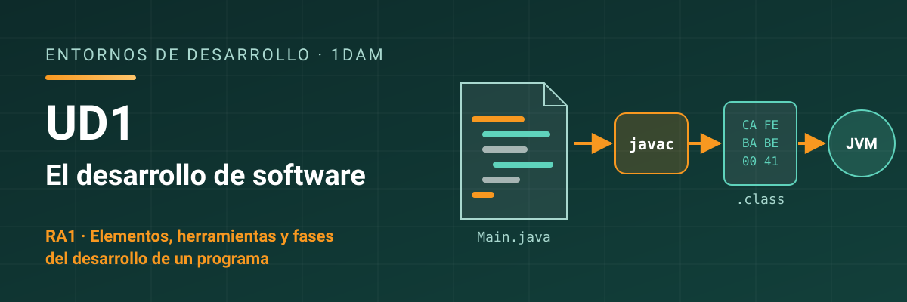

# Entornos de Desarrollo - UD1 El desarrollo de software

Unidad 1 El desarrollo de software. 1DAM.

## Resultado de aprendizaje

Esta unidad trabaja el **RA1** y sus criterios de evaluación: [ver resultado de aprendizaje y criterios de evaluación](./resultados-aprendizaje.md).

## Referencias

- [dev.java](https://dev.java/): portal oficial para aprender Java y sus herramientas (`javac`, `java`, `jar`, `javap`…), mantenido por Oracle. Está en inglés. Sirve para toda la unidad y para el resto del curso.
- [La Guía de Scrum](https://scrumguides.org/): la definición oficial de Scrum, escrita por sus creadores. Es corta y gratuita; en la propia web tienes la traducción al español (*Translations*).
- [Manifiesto por el Desarrollo Ágil de Software](https://agilemanifesto.org/iso/es/manifesto.html): los cuatro valores, en español, con un enlace a los doce principios.

## Contenidos

1. [El programa y el sistema informático](./01-programas-y-sistema.md)
2. [Lenguajes de programación](./02-lenguajes-de-programacion.md)
3. [Del código fuente al ejecutable](./03-del-codigo-al-ejecutable.md)
4. [Fases del desarrollo y ciclo de vida](./04-fases-del-desarrollo.md)
5. [Metodologías ágiles](./05-metodologias-agiles.md)
6. [Herramientas del desarrollo de software](./06-herramientas-del-desarrollo.md)
7. [Resumen y mapa mental](./07-resumen.md)

## Licencia

Este material se distribuye bajo licencia **Creative Commons BY-NC-SA 4.0**. Consulta las condiciones en [LICENSE.md](./LICENSE.md).
