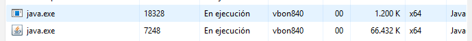

# Un programa por dentro

<!-- Completa cada sección. Borra los comentarios como este cuando termines.
     Respeta el formato de las tablas: así podrás compararlas con la solución. -->

## Versión de Java

<!-- Pega la primera línea de la salida de «java -version». -->

```text
java 22.0.1 2024-04-16
```

## Salida del programa

<!-- Pega lo que aparece en la terminal al ejecutar «java Media.java» con 4 notas: 6, 8, 9 y 5. -->

```text
¿Cuántas notas? 4
Nota 1: 6
Nota 2: 8
Nota 3: 9
Nota 4: 5
Media: 7.0

```

## El proceso

<!-- Con el programa esperando la cantidad de notas. La captura va en img/proceso.png. -->

| Dato | Valor |
|------|-------|
| Sistema operativo | Windows 11 Pro Education |
| Herramienta que has usado | Símbolo del sistema |
| Nombre del proceso | java.exe |
| Identificador (PID) |18328, 7248 |
| Memoria que ocupa | 1.2.. K, 66.432 K |
| Procesador (%) | 00 |
| Estado en que está, según el tema 1, y por qué | Bloqueado |



## Componentes en cada paso

<!-- «Componentes»: procesador (ALU, registros), memoria, teclado, pantalla, sistema operativo…
     «Zona de memoria»: código, datos estáticos, montículo, pila, o «—» si no se crea nada. -->

| # | Paso del programa | Qué ocurre | Componentes que intervienen | Zona de memoria |
|---|-------------------|------------|-----------------------------|-----------------|
| 1 | Escribes `java Media.java` y pulsas Intro | | | |
| 2 | `Scanner entrada = new Scanner(System.in);` | | | |
| 3 | `System.out.print("¿Cuántas notas? ");` | | | |
| 4 | `int cantidad = entrada.nextInt();` | | | |
| 5 | `int[] notas = new int[cantidad];` | | | |
| 6 | El bucle que pide y lee cada nota | | | |
| 7 | `double media = calcularMedia(notas);` | | | |
| 8 | `System.out.println("Media: " + media);` | | | |
| 9 | Termina `main` | | | |

## Cuando se acaba la memoria

<!-- Pega las dos primeras líneas del error y explica qué ha pasado y en qué zona de memoria. -->

```text

```

Explicación:

## Preguntas

1. ¿Cuántas tramas hay en la pila mientras se ejecuta `calcularMedia`? ¿De qué métodos son?

   <!-- Tu respuesta -->

2. ¿Por qué el proceso casi no usa el procesador mientras espera que escribas?

   <!-- Tu respuesta -->

3. Si ejecutas el programa dos veces a la vez, en dos terminales, ¿cuántos programas y cuántos procesos hay? ¿Comparten la memoria?

   <!-- Tu respuesta -->

4. El programa escribe en la pantalla con `System.out`. ¿Por qué no puede escribir directamente en ella?

   <!-- Tu respuesta -->
