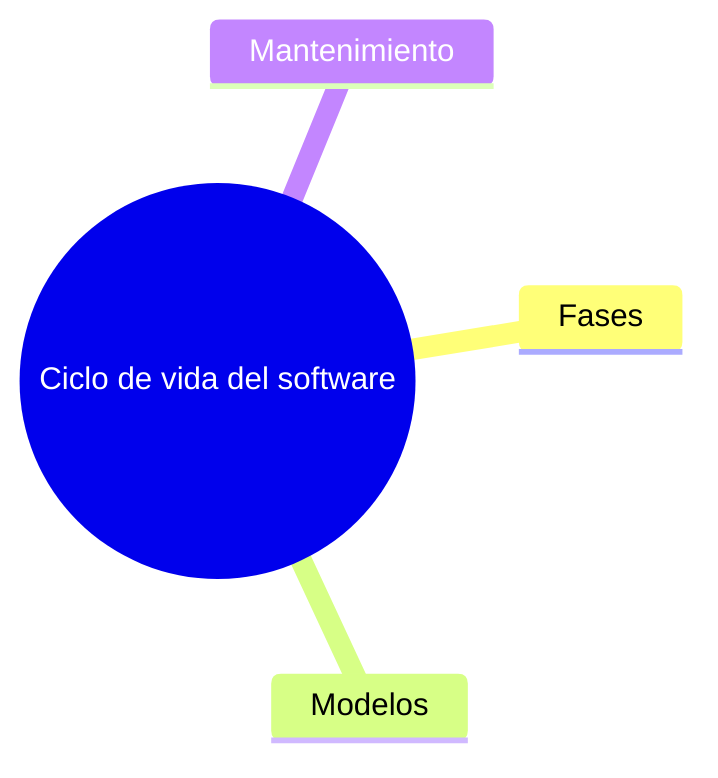

# Las fases de un proyecto: reservas del Polideportivo Los Álamos

<!-- Completa cada sección. Borra los comentarios como este cuando termines.
     Respeta el formato de las tablas: así podrás compararlas con la solución. -->

## Requisitos

<!-- Al menos cinco funcionales (RF1…) y tres no funcionales (RNF1…). Añade las filas que necesites.
     «Cómo se comprobaría»: la prueba que demostraría que se cumple. -->

| Id | Tipo | Requisito | Cómo se comprobaría |
|----|------|-----------|---------------------|
| RF1 | Funcional | | |
| RNF1 | No funcional | | |

## Fases

<!-- Actividades concretas de ESTE proyecto, al menos dos por fase, y el resultado de cada fase. -->

| Fase | Qué se haría en este proyecto | Resultado |
|------|-------------------------------|-----------|
| Análisis | | |
| Diseño | | |
| Codificación | | |
| Pruebas | | |
| Documentación | | |
| Explotación | | |
| Mantenimiento | | |

## Mantenimiento

<!-- Tipo: Correctivo, Adaptativo, Perfectivo o Preventivo. -->

| Situación | Tipo | Por qué |
|-----------|------|---------|
| Se descubre que, pulsando muy rápido dos veces, una persona puede reservar la misma pista a la misma hora dos veces | | |
| Los navegadores dejan de admitir una función que usaba el calendario de reservas | | |
| Los vecinos piden recibir un aviso en el móvil una hora antes de su reserva | | |
| El equipo reorganiza el código del cálculo de precios, que nadie entiende bien, sin cambiar lo que hace | | |

## Modelo de ciclo de vida

Modelo elegido:

Por qué (al menos tres características del caso):

1.
2.
3.

Modelos que descarto y por qué:

1.
2.

## Mapa mental

<!-- Completa el mapa: nodo central y tres ramas (fases con sus resultados, modelos con su idea clave
     y tipos de mantenimiento). La sangría marca qué nodo cuelga de cuál. -->

## Preguntas

1. ¿Qué fase te parece la más importante en este proyecto y por qué?

   <!-- Tu respuesta -->

2. ¿Qué riesgo ves en el pago sin decidir? ¿Cómo lo tendrías en cuenta al organizar el proyecto?

   <!-- Tu respuesta -->
